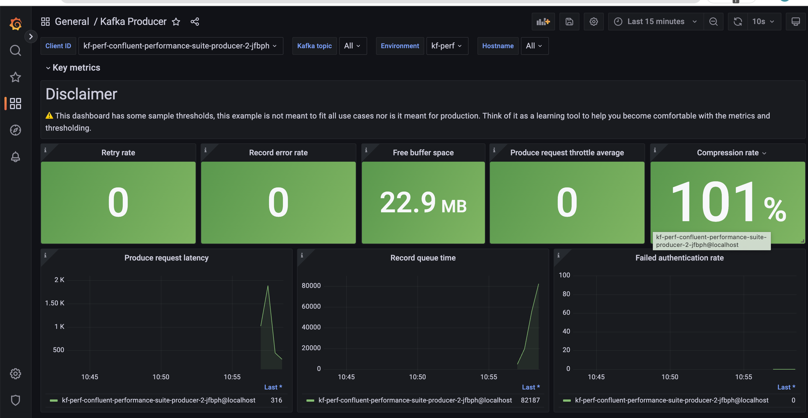
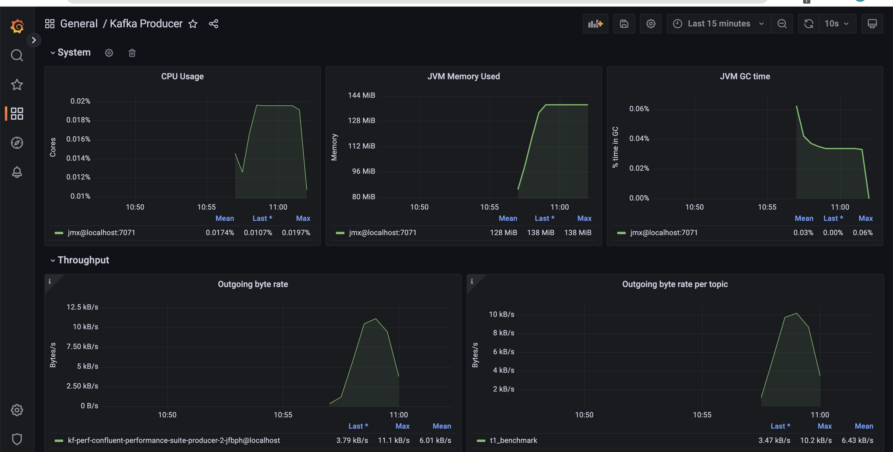
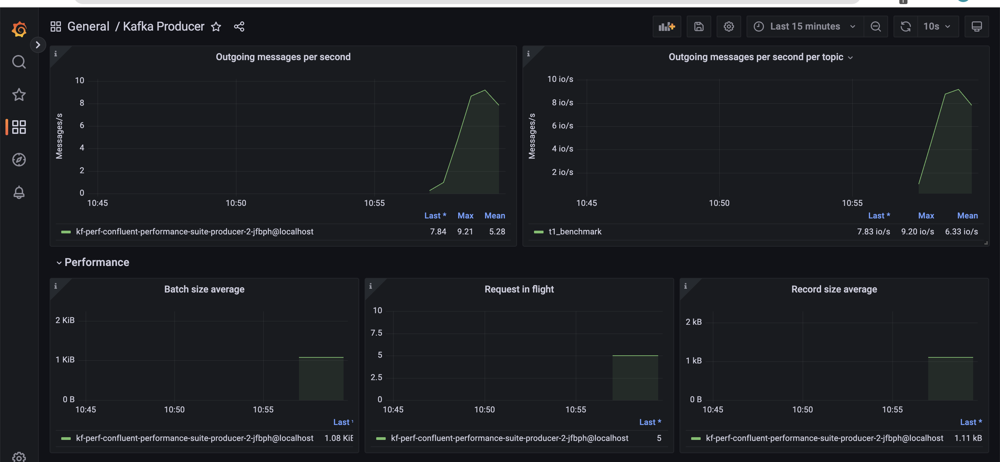
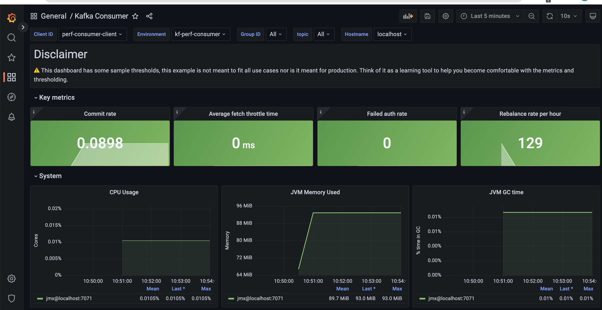
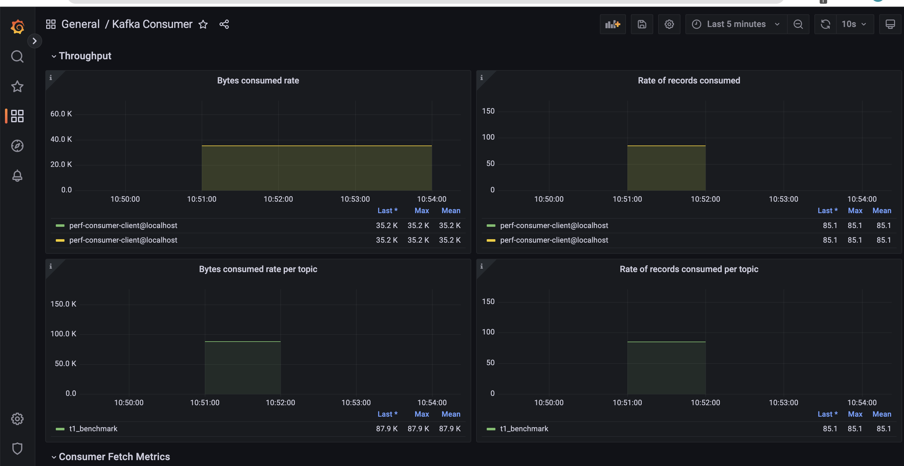
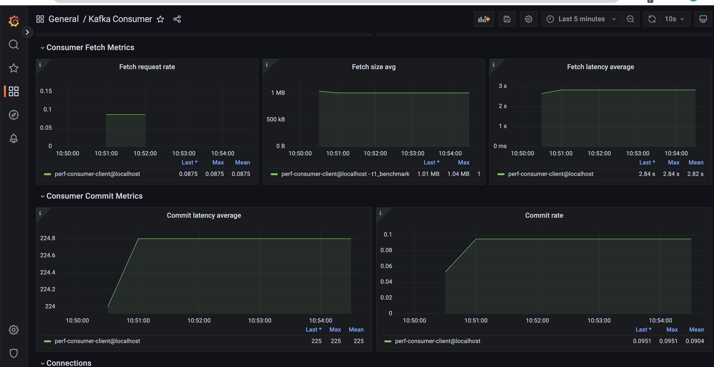

Kafka tuning trades off four things: **throughput, durability, availability, latency.** Benchmarking means: establish a baseline (throughput, end-to-end latency), tweak producer/consumer configs, re-run, repeat.

A good benchmark rig must be:
1. **Realistic.** No toy setups.
2. **Recorded.** Snapshot and visualise every run.
3. **Easy to set up.** A misconfigured rig gives false confidence.

## Existing tools fall short

| Tool | Strength | Gaps |
|---|---|---|
| [OpenMessaging Benchmark](https://openmessaging.cloud/docs/benchmarks/) | Realistic, vendor-neutral, distributed | No end-to-end latency; heavy Terraform/Ansible setup; [Helm option](https://github.com/openmessaging/benchmark/blob/master/deployment/kubernetes/helm/README.md) undocumented; no dashboards |
| [Trogdor](https://github.com/apache/kafka/tree/trunk/trogdor) | Perf + [fault injection](https://cwiki.apache.org/confluence/display/KAFKA/Fault+Injection) | [RoundTripWorkload](https://github.com/apache/kafka/tree/trunk/trogdor#roundtripworkload) isn't true end-to-end; no visualisable metrics; agents must run on brokers |
| JMeter + [PepperBox](https://pepperbox.gslab.com/) | Easy setup | Custom consumer code; no latency measurement |
| Kafka perf tools | Producer, consumer and end-to-end latency built in | No parallel clients; manual reset per run; no metric history |

Kafka's perf tools are the lowest common denominator. We fix their gaps: parallelism, repeatability, metrics.

## Baseline: Kafka perf tools

Shared client config (`kafka.properties`):

```
bootstrap.servers=<bootstrap>:9092
security.protocol=SASL_SSL
sasl.mechanism=PLAIN
sasl.jaas.config=org.apache.kafka.common.security.plain.PlainLoginModule required username='<key>' password='<secret>';
```

```bash
kafka-topics --create --if-not-exists --topic mytopic \
  --bootstrap-server <bootstrap>:9092 --replication-factor 3 --partitions 1 \
  --command-config kafka.properties

kafka-producer-perf-test --topic mytopic --num-records 10000 --record-size 1024 \
  --throughput -1 --producer-props acks=all client.id=producer-01 \
  --producer.config kafka.properties --print-metrics

kafka-consumer-perf-test --topic mytopic --bootstrap-server <bootstrap>:9092 \
  --messages 1000 --consumer.config kafka.properties --print-metrics --timeout=100000
```

Output: per-interval throughput, avg/max latency, p50–p99.9, plus full client metrics (batch size, retries, commit latency, lag).

The loop is OODA: **observe** metrics, **orient** on which config caused them, **decide** the next change, **act** by re-running. With raw CLIs this breaks down: no parallel producers, no central metrics, no run history.

## Take 2: Kubernetes Jobs

Run the perf tools as a Job; scale clients via `parallelism`; mount `kafka.properties` from a Secret; create the topic in an init container.

```yaml
apiVersion: batch/v1
kind: Job
metadata:
  name: producer
spec:
  completions: 3
  parallelism: 3
  template:
    spec:
      initContainers:
        - name: topics
          image: confluentinc/cp-kafka:7.3.2
          command: ["/bin/sh", "-c", "kafka-topics --if-not-exists --create --topic mytopic --bootstrap-server <bootstrap>:9092 --replication-factor 3 --partitions 1 --command-config /mnt/kafka.properties"]
          volumeMounts: [{ name: kafka-properties, mountPath: /mnt }]
      containers:
        - name: producer
          image: confluentinc/cp-kafka:7.3.2
          command: ["/bin/sh", "-c", "kafka-producer-perf-test --topic perf-test --num-records 10000 --record-size 1024 --throughput -1 --producer-props acks=1 batch.size=1000 linger.ms=100 compression.type=lz4 --producer.config /mnt/kafka.properties"]
          volumeMounts: [{ name: kafka-properties, mountPath: /mnt }]
      volumes:
        - name: kafka-properties
          secret: { secretName: kafka-client-config }
      restartPolicy: Never
```

**Metrics:** bake a JMX exporter (port 7071) and Prometheus into the image. Run Prometheus in **agent mode** to push via `remote_write` (the server needs the [remote write receiver](https://prometheus.io/docs/prometheus/latest/feature_flags/#remote-write-receiver)); label each run.

```bash
./prometheus --enable-feature=agent --config.file=/prom/prometheus.yml
```

Still manual: edit, `kubectl apply`, track. The full testing loop:

1. Baseline on standard hardware and conditions
2. Define scenarios as producer/consumer configs
3. Run
4. Client black box: throughput, latency
5. Client white box: JMX
6. Server black box: throughput, latency
7. Server white box: JMX
8. Logs, raising levels as needed

Repeat 3–8; judge by deviation from the baseline.

## Take 3: Helm chart

Templatise the Secret, producer Job, consumer Job and Prometheus config. **Each OODA iteration = one Helm release with its own values.** `producer.count` and `consumer.count` fan out parallel Jobs; consumers end on a timeout.

| Profile | Producer settings |
|---|---|
| Throughput | `acks: 1`, `batch.size=100000 linger.ms=100 compression.type=lz4` |
| Durability | `acks: all`, `enable.idempotence=true max.in.flight.requests.per.connection=1` |

```yaml
topic: { name: t1_benchmark, replicationFactor: 3, partitions: 1 }
producer:
  count: 3
  recordsCount: 1000
  recordSizeBytes: 1024
  throughput: "-1"
  acks: all
  params: "enable.idempotence=true max.in.flight.requests.per.connection=1"
consumer: { count: 1, messagesCount: 1000, timeout: 100000 }
```

### Dashboards

A companion chart wraps [kube-prometheus-stack](https://github.com/prometheus-community/helm-charts/tree/main/charts/kube-prometheus-stack) with Prometheus, Grafana and producer/consumer dashboards pre-wired.

```bash
helm upgrade --install prom-stack ./kube-prometheus-kafka-chart
helm upgrade --install march-25-2023-durability-producer ./kafka-performance-metrics-chart --values durability-producer-values.yml
helm upgrade --install march-25-2023-durability-consumer ./kafka-performance-metrics-chart --values durability-consumer-values.yml
```













### Other metric backends

Any Prometheus `remote_write` target works (e.g. New Relic):

```yaml
prometheus:
  remote_write:
    - url: https://metric-api.newrelic.com/prometheus/v1/write?prometheus_server=kafka-perf-test
      bearer_token: <token>
```

Code: [Platformatory/kafka-performance-suite](https://github.com/Platformatory/kafka-performance-suite).
