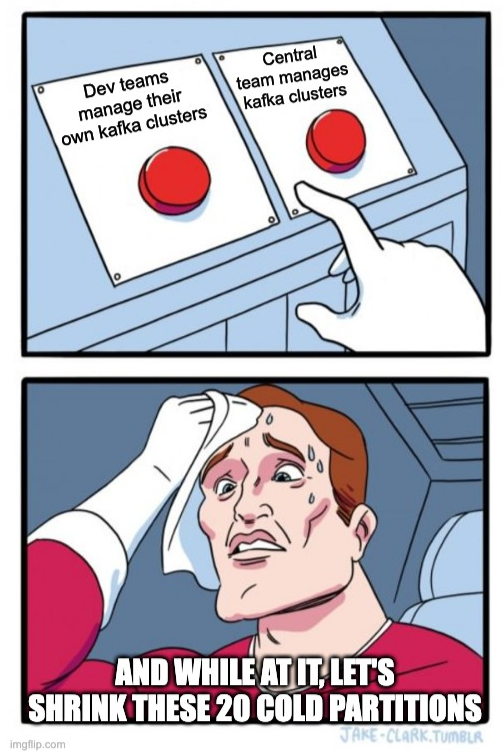

# Introduction

Running Kafka as a platform is easy with a handful of teams and clusters. Then it isn't.

Recurring clean-up jobs:
- Migrate topics within a cluster (partitions can't shrink: create and mirror), or move hot, noisy topics to another cluster
- Move a whole cluster (better infra, or disaster)
- Change auth and redistribute credentials
- Fix developers' untuned client configs

Kafka clients do most of the work, so every change hits every client. Put indirection between clients and brokers, as proxies do for HTTP:

| Capability | Use |
|---|---|
| Dynamic cluster routing (`bootstrap.servers` not hard-coded) | Whole-cluster migrations |
| Topic routing by a higher-order routing primitive | Topic migrations; many message types per topic |
| Credential mediation (vend, rotate, revoke server-side) | Auth changes |
| Config profiles (latency, throughput, durability, availability) | Best-practice client configs |

Four approaches follow.

# Approach 1: Language SDKs + rule-based routing

Before creating a Kafka client, an SDK calls a catalog service:
1. Authenticated REST call (basic auth or OAuth) stating intent (produce/consume) on a topic or prefix, or routed by client ID
2. Receives bootstrap servers, optionally with mediated Kafka and Schema Registry credentials
3. Caches with a TTL
4. Returns a configured client

Works beyond containers. Costs: a secured catalog service you run (with multi-cluster inventory discovery and routing rules), plus idiomatic SDKs per language, so application code changes.

flowchart LR

 subgraph PRODUCERS["Producers"]
        P1("Producer 1")
        P2("Producer 2")
        P3("Producer 3")
  end
 subgraph CG1["Consumer Group 1"]
        C1("Consumer 1")
  end
 subgraph CG2["Consumer Group 2"]
        C2("Consumer 1")
        C3("Consumer 2")
  end
 subgraph CG3["Consumer Group 3"]
        C4("Consumer 1")
        C5("Consumer 2")
  end

 subgraph GW["Rule Based Routing Layer"]
    direction LR
        API["APIs (Kong)"]
        US["Upstream (Catalog Service)"]
  end
 subgraph K1["Kafka Cluster 1"]
        B1["Broker 1"]
        B2["Broker 2"]
        B3["Broker 3"]
  end
subgraph K2["Kafka Cluster 2"]
        B4["Broker 1"]
        B5["Broker 2"]
        B6["Broker 3"]
  end

    P1 & P2 & P3 -- 1.GetInfo --> GW -- 2.Response --> P1 & P2 & P3
    CG1 & CG2 & CG3  -- 1.GetInfo --> GW -- 2.Response --> CG1 & CG2 & CG3
    P1 -- 3.Produces --> K1
    P2 -- 3.Produces --> K2
    P3 -- 3.Produces --> CC
    API --> US
    K1 -- 4.Consumes --> CG1
    K2 -- 4.Consumes --> CG2
    CC -- 4.Consumes --> CG3

    %% Styling
    classDef kafkaStyle fill:#e0f7e9,stroke:#4caf50,stroke-width:2px;
    class K1,K2 kafkaStyle;

Details: [Part 2: Rule Based Routing](https://platformatory.io/blog/unified-access-layer-part-2-rule-based-routing).

# Approach 2: Service mesh (Kubernetes)

Clients produce and consume via a local sidecar (e.g. Envoy in Istio or Kuma). Mesh filters route requests to the right brokers, with discovery, load balancing, retries, timeouts and security policy applied in the mesh, not the app.

flowchart TD
  %% Kubernetes environment
  subgraph K8S ["Kubernetes"]
    direction TB
    
    %% Service Mesh (Istio)
    subgraph Istio ["Service Mesh (Istio)"]
      direction TB
      
      %% Producer Pods
      subgraph P1Pod ["Pod: Producer 1"]
        direction TB
        P1("Producer 1")
        P1Envoy["Envoy Proxy (P1)"]
        Filter1["Mesh Filter (P1)"]
        P1 -->|Produces To| P1Envoy --> Filter1
      end
      
      subgraph P2Pod ["Pod: Producer 2"]
        direction TB
        P2("Producer 2")
        P2Envoy["Envoy Proxy (P2)"]
        Filter2["Mesh Filter (P2)"]
        P2 -->|Produces To| P2Envoy --> Filter2
      end

      %% Kafka Cluster 1
      subgraph K1 ["Kafka Cluster 1"]
        direction TB
        subgraph Broker1Pod1 ["Pod: Broker 1"]
          direction TB
          Broker1Envoy1["Envoy Proxy (Broker 1)"]
          Broker1_1("Broker 1")
          Broker1Envoy1 --> Broker1_1
        end

        subgraph Broker1Pod2 ["Pod: Broker 2"]
          direction TB
          Broker1Envoy2["Envoy Proxy (Broker 2)"]
          Broker1_2("Broker 2")
          Broker1Envoy2 --> Broker1_2
        end
        
        subgraph Broker1Pod3 ["Pod: Broker 3"]
          direction TB
          Broker1Envoy3["Envoy Proxy (Broker 3)"]
          Broker1_3("Broker 3")
          Broker1Envoy3 --> Broker1_3
        end
        
        Topic1["Topic 1"]
        Topic2["Topic 2"]
      end
      
      %% Kafka Cluster 2
      subgraph K2 ["Kafka Cluster 2"]
        direction TB
        subgraph Broker2Pod1 ["Pod: Broker 1"]
          direction TB
          Broker2Envoy1["Envoy Proxy (Broker 1)"]
          Broker2_1("Broker 1")
          Broker2Envoy1 --> Broker2_1
        end

        subgraph Broker2Pod2 ["Pod: Broker 2"]
          direction TB
          Broker2Envoy2["Envoy Proxy (Broker 2)"]
          Broker2_2("Broker 2")
          Broker2Envoy2 --> Broker2_2
        end
        
        subgraph Broker2Pod3 ["Pod: Broker 3"]
          direction TB
          Broker2Envoy3["Envoy Proxy (Broker 3)"]
          Broker2_3("Broker 3")
          Broker2Envoy3 --> Broker2_3
        end
        
        Topic3["Topic 3"]
        Topic4["Topic 4"]
      end

      %% Consumer Pods
      subgraph C1Pod ["Pod: Consumer 1"]
        direction TB
        C1("Consumer 1")
        C1Envoy["Envoy Proxy (C1)"]
        Filter3["Mesh Filter (C1)"]
        C1 -->|Consumes From| C1Envoy --> Filter3
      end

      subgraph C2Pod ["Pod: Consumer 2"]
        direction TB
        C2("Consumer 2")
        C2Envoy["Envoy Proxy (C2)"]
        Filter4["Mesh Filter (C2)"]
        C2 -->|Consumes From| C2Envoy --> Filter4
      end
    end
  end

  %% Connections
  Filter1 -->|Produces to| Topic1 & Topic2
  Filter2 -->|Produces to| Topic3 & Topic4
  Topic1 -->|Consumed by| Filter3
  Topic3 -->|Consumed by| Filter4
  Broker1Envoy1 -->|Manages| Topic1 & Topic2
  Broker1Envoy2 -->|Manages| Topic1 & Topic2
  Broker1Envoy3 -->|Manages| Topic1 & Topic2
  Broker2Envoy1 -->|Manages| Topic3 & Topic4
  Broker2Envoy2 -->|Manages| Topic3 & Topic4
  Broker2Envoy3 -->|Manages| Topic3 & Topic4

  %% Styling
  classDef kafkaStyle fill:#e0f7e9,stroke:#4caf50,stroke-width:2px;
  class K1,K2 kafkaStyle;

Downsides:
- More middleware; needs Envoy-level expertise
- Pays off only with many tenants; needs careful policy, automation and isolation planning
- Another hop in the request path, plus cross-team governance

# Approach 3: Kafka gateway (virtualised clusters and topics)

A Kafka-protocol proxy (e.g. [Conduktor Gateway](https://docs.conduktor.io/gateway/)) between clients and clusters, extensible with plugins.

flowchart TD
 subgraph PRODUCERS["Producers"]
        P1("Producer 1")
        P2("Producer 2")
  end
 subgraph CG1["Consumer Group 1"]
        C1("Consumer 1")
  end
 subgraph CG2["Consumer Group 2"]
        C2("Consumer 2")
        C3("Consumer 3")
  end
 subgraph CONSUMERS["Consumers"]
        CG1
        CG2
  end
 subgraph GW["Kafka Gateway"]
    direction LR
        AA["Authentication & Authorization"]
        PL["Plugins"]
  end
 subgraph K1["Kafka Cluster"]
        B1["Broker 1"]
        B2["Broker 2"]
        B3["Broker 3"]
  end
 subgraph D1["Destinations"]
        K1
        CC["Confluent Cloud"]
  end
  subgraph A1["Producers & Consumers"]
    direction LR
    PRODUCERS
    CONSUMERS
  end
    P1 & P2 -- Produce --> GW -- Consume --> CG1 & CG2
    K1 & CC -- Messages --> GW
    AA --> PL
    GW -- Forward ---> K1 & CC

  classDef kafkaStyle fill:#e0f7e9,stroke:#4caf50,stroke-width:2px;
  class A1,D1 kafkaStyle;

- Clients only change `bootstrap.servers`.
- Authenticates like a broker (PLAINTEXT, SSL, SASL_SSL, mTLS).
- **Interceptors** hold the logic, routing included; chained as a pipeline on produce, reversed on response.

| Pros | Cons |
|---|---|
| Protocol-compliant: multi-vendor | Adds latency (ms), more with encryption and long plugin chains |
| Central security, compliance and monitoring insight | Proprietary: lock-in risk |
| One team manages access and config | Complex initial setup |

# Approach 4: Data catalog + self-service portal

Catalog Kafka assets (clusters, topics, schemas) for discovery and governance; ideally with native Kafka support.

| Catalog | Kafka support |
|---|---|
| Apache Atlas | Only OSS option integrating well: lineage, classification/tagging, search |
| Confluent Stream Catalog | Schemas, topics, connectors, clusters, pipelines, Flink pools (Confluent Cloud) |
| AWS Glue, Azure Catalog | Limited (MSK integration) |
| GCP | Pub/Sub catalog |
| Collibra | Limited; adds streaming data-quality checks |
| OpenMetadata, Unity Catalog, Amundsen, Hive metastore | Alternatives |

flowchart TD

 subgraph PRODUCERS["Producers"]
        P1("Producer 1")
        P2("Producer 2")
  end
 subgraph CG1["Consumer Group 1"]
        C1("Consumer 1")
  end
 subgraph CG2["Consumer Group 2"]
        C2("Consumer 2")
        C3("Consumer 3")
  end
 subgraph CONSUMERS["Consumers"]
        CG1
        CG2
  end
 subgraph SSP["Self-Service Portal"]
        PO1["Portal"]
  end
 subgraph DC["Data Catalog for Kafka"]
    direction LR
        API["APIs"]
        MM["Metadata Management & Lineage"]
        TL["Classification & Tagging"]
        DG["Data Governance"]
        DQ["Data Quality"]
  end
 subgraph SSPDC["Self-Service Portal & Data Catalog"]
        direction TB
        SSP
        DC
  end
 subgraph KC["Kafka Cluster"]
        B1["Broker 1"]
        B2["Broker 2"]
        B3["Broker 3"]
  end
subgraph KC1["Kafka Cluster"]
        B4["Broker 1"]
        B5["Broker 2"]
        B6["Broker 3"]
  end
 subgraph D1["Destinations"]
        direction TB
        KC
        KC1
        CC["Cloud Provider (Confluent, AWS MSK, Azure, GCP)"]
        
  end
  subgraph A1["Producers & Consumers"]
    direction LR
    PRODUCERS
    CONSUMERS

  end
    P1 & P2 -- Produce (with Metadata) --> DC -- Consume (with Metadata) --> CG1 & CG2
    KC & KC1 & CC -- Messages (with Metadata) --> DC    
    DC -- Forward (with Metadta) ---> KC & KC1 & CC
    SSP -- Configures --> DC
    

  classDef kafkaStyle fill:#e0f7e9,stroke:#4caf50,stroke-width:2px;
  class D1,SSPDC,A1 kafkaStyle;

Catalog APIs let you automate metadata and build on top. You still need a discovery interface and a self-service portal for credential vending. Costs: complexity, performance, consistency, lock-in, maintenance, learning curve.

# Conclusion

A central Kafka team that can create, label and vend access reduces dependencies for itself and for every producer and consumer. That's how the platform and the organisation scale.
