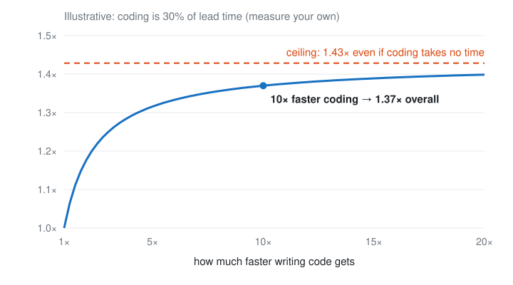
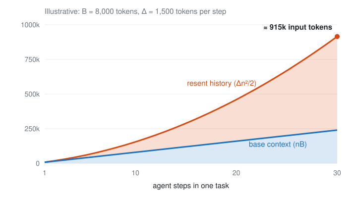

On 26 January 2026, curl announced the end of its bug bounty:[^curl]

- **Ran:** 2019 to 31 January 2026
- **Paid:** more than $100,000 for 87 confirmed vulnerabilities
- **Valid reports:** above 15% in earlier years, below 5% from 2025
- **Cause:** a flood of AI-generated reports, each costing a maintainer time to disprove[^curl]

A project that had outlasted decades of real attackers was worn down by plausible text. The craft those reports counterfeit is the one I spent twenty years learning.

* * *

The first program I was proud of was a cheat. The table was a rectangle of green pixels, the cue a thin line I could never quite trust, and the stranger on the other side was winning. Yahoo Pool ran as a Java applet, and with patience you could tweak it to draw the line your shot would take: an aimer. A cheap thrill, and a better education in how software works than school, because to cheat a system you first have to understand it.

Then the usual path for my generation: some questionable Winsock tinkering I won't describe; PHP, which paid; the long climb to *real* programming in C++, where you learn what memory is; data structures until they were reflexes; competitive problems at midnight; hundreds of Project Euler problems for no reason except the next one; a dozen open-source projects, mostly for bragging rights. None of it efficient, all of it the point. Each skill was paid for in hours, and the payment was the pleasure.

Today it feels like a lost trade. The code still has to exist, but the function I honed, turning a fuzzy intention into a precise program by hand, is the one the machines now perform for everyone, instantly, for the price of a coffee. The aimer I wrote to cheat at pool is the whole profession's default. The line is drawn for you; nobody has to learn to aim.

Peter Naur named what's at stake in 1985. Programming is "the programmers' building up knowledge of a certain kind": a theory of how the problem maps onto the code, which lives in people's heads and "could not conceivably be expressed" in full. A program dies "when the programmer team possessing its theory is dissolved." It keeps running; nobody can change it intelligently.[^naur]

So who holds the theory of a program no human wrote?

* * *

Slop was 2025's word of the year: "digital content of low quality that is produced usually in quantity by means of artificial intelligence."[^mw-slop] The definition is economic. Slop is cheap, plentiful, and someone else's job to clean up.

Writing hurts more than the code. It's the other craft I cultivated, making a story land, and it's disrupted the same way. This essay was drafted with an AI from my notes, then argued with, cut and rewritten. The machine is a good researcher and a tireless first draft. It has nothing to say; that part was mine, and it's the only part worth reading.

Will children growing up now feel what I felt at fourteen, making a machine do something it wasn't meant to, or finding the sentence that says exactly what I meant? The early evidence is thin:

- **Study:** 54 participants writing essays over several months, with ChatGPT, a search engine or nothing (MIT Media Lab preprint, 2025)
- **Unaided writers:** the strongest, most widely distributed brain connectivity
- **ChatGPT writers:** the weakest, and trouble quoting essays they had just written
- **Caveats:** small sample, tight time limits, a preprint[^brain-chatgpt]

It matches what anyone who learned a craft knows: the struggle *is* the skill, laid down in layers.

Kids will still learn to aim, the way people still learn chess decades after engines beat the best humans: as a sport and an art. What they lose is the economic reason. A craft survives as a hobby long after it stops being a trade. That's worth something, and a long way from where I started.

* * *

Software engineering has meanwhile split into two shapes.

The **software factory** is an old idea. Hitachi pioneered the factory model for large-scale software in the late 1960s, chasing process, reuse and quality control at industrial scale.[^cusumano] The 2026 version is the *dark factory*, named after lights-out plants: the top of a five-level ladder of AI-assisted coding, with rules like "Code must not be written by humans. Code must not be reviewed by humans." Humans write goals, scenarios and hidden acceptance tests; the factory runs.[^dark-factory] Throughput is the product, and code is an intermediate good, like sawdust.

The **tokenmaxxing artisan** is one engineer running a dozen agents, with token spend worn as a badge; some companies now score employees on it.[^wbur] The leverage is real, at a price. Q1 2026, 12,000 developers at 200 companies:[^jellyfish]

- **Lowest-spending fifth:** about $3 of tokens for the quarter, 11 merged PRs
- **Highest-spending fifth:** $1,822, 23 merged PRs
- **Marginal cost:** $$\frac{\$1{,}822 - \$3}{23 - 11} \approx \$150$$ per extra merged PR, less than an hour of a senior engineer

A merged PR measures activity, and both shapes share a blind spot. The factory swaps the person who holds Naur's theory for a test suite. The artisan keeps that person and buries them in more code than one person can hold. Either way the theory thins out, and by Naur's definition the program is born dead.

* * *

Does any of it move faster? The most careful evidence:

- **METR, 2025:** randomised trial, 16 experienced open-source developers, 246 tasks in repositories they knew. AI made them 19% *slower*; they had expected 24% faster, and afterwards believed they had been 20% faster.[^metr-2025]
- **METR, late 2025 follow-up:** 57 developers, a speedup estimate with confidence intervals spanning zero, "only very weak evidence." The study is being redesigned, partly because developers now refuse to work without AI.[^metr-2026]

The tools have improved and individual speedups are probably real on many tasks. The perception gap has held: people misjudge their own speed when a machine does the typing.

Then the theory of constraints: a system's throughput is set by its bottleneck, and speeding up any other step piles inventory in front of it.[^goldratt] Delivery runs understand, decide, write, review, test, release, operate. Amdahl's law gives the overall speedup $$S$$ when a step taking share $$p$$ of lead time gets $$k$$ times faster:

$$S = \frac{1}{(1 - p) + p/k}$$

If writing code is 30% of lead time ($$p = 0.3$$; illustrative, measure your own):

- **10× faster coding:** $$S = 1/(0.7 + 0.03) \approx 1.37\times$$ faster delivery
- **Infinitely fast coding:** $$S \to 1/0.7 \approx 1.43\times$$

*Illustrative: coding at 30% of lead time.*

The inventory piles up in the worst place, the review queue, the one step that still needs whoever holds the theory:

- **DORA 2025 (about 5,000 respondents):** higher AI adoption now tracks higher throughput, and higher delivery *instability*.[^dora-2025]
- **Faros (22,000 developers, two years):** tasks completed up 34%, bugs per developer up 54%.[^faros]

And the business moves at the speed of everything outside the editor: deciding what to build, approvals, legal review, procurement, the migration nobody schedules, the customer who has to change how they work. AI speeds up the cheapest link; the chain sets the pace.

* * *

Is the saving real? Only once the whole change is priced:

$$C_{\text{change}} = C_{\text{tokens}} + t_{\text{review}}\, w + P_{\text{defect}}\, C_{\text{defect}} + P_{\text{vuln}}\, C_{\text{breach}} + C_{\text{slop}}$$

where $$t_{\text{review}}$$ is review time, $$w$$ the engineer's rate, and $$C_{\text{slop}}$$ the cost pushed onto someone else.

Tokens are the cheap term. The rest:

- **Review.** Code nobody holds a theory of is slower to review than a colleague's. Typing time saved is spent again, with interest, by whoever has to understand it.
- **Defects.** 54% more bugs per developer grows the defect term with throughput.
- **Vulnerabilities.** Across 100+ models and 80 tasks built around common weaknesses, generated code introduced a security flaw in 45% of cases, above 70% in Java.[^veracode]
- **Invented dependencies.** Of 2.23 million generated package references, 19.7% named packages that don't exist: 205,000+ unique names, each free for an attacker to register. The attack is called *slopsquatting*.[^package-hallucination]
- **Externalised slop.** curl's maintainers paid for other people's slop with their evenings, until they closed the bounty.[^curl]

Net: real at the keyboard, smaller at the pull request, near zero or negative once review, defects and security are priced in. The gains go to teams whose bottleneck really was typing.

* * *

Security makes the strongest case that the gains are marginal.

Security is an economic property: how much would breaking this cost, and who would pay it? Scarcity used to protect most software. Skilled attackers were expensive, slow and few. Not any more:

- **XBOW, 2025:** an autonomous pentester, 1,000+ vulnerability reports in a few months, top of HackerOne's US leaderboard.[^xbow]
- **DARPA AI Cyber Challenge, August 2025:** autonomous systems found 54 of 63 planted vulnerabilities, patched 43, and found 18 real ones nobody planted.[^aixcc]
- **GTG-1002, November 2025:** an espionage campaign assessed as Chinese state-sponsored used an AI coding agent as an intrusion engine against about thirty targets, with AI doing an estimated 80–90% of the work.[^gtg-1002]

The same capability defends, and the defensive results are encouraging. The asymmetry stays: defenders must be right everywhere, and the attacker's cost per attempt has fallen by orders of magnitude. The question for every team is now what breaking this would cost, and how fast that number is falling. Code generated quickly, reviewed thinly and full of plausible dependencies is cheap to break.

Then sign-off. How autonomous is autonomous enough to approve a change to production, a payment flow or an identity system? Look at who answers after a breach: Uber's former chief security officer was convicted in 2022 over the handling of its 2016 breach, believed to be the first criminal prosecution of an executive over a data breach.[^uber-cso] Regulators, courts and boards look for a person with a name. A slide attributed to a 1979 IBM training session put it in sixteen words: "A computer can never be held accountable. Therefore a computer must never make a management decision."[^ibm-1979] No dark factory takes the regulator's call, so every autonomous pipeline ends at a human signature, and that human needs enough of the theory to mean it.

**For engineering leaders**, the evidence points to a few practical moves:

- measure lead time and review-queue age, and stop counting PRs or tokens
- budget reviewer time explicitly as AI output grows
- pin and allowlist dependencies, and scan every generated change
- require a named human sign-off on anything touching money, identity or production

* * *

Across the industry, the fashionable obituary says software is dead: models write the code and the profession deflates. Jevons saw the opposite with coal in 1865: more efficient engines made coal worth burning for more things, and consumption rose.[^jevons] Cheaper code does the same to software, and customer service shows the two ways to spend it.

- **Klarna, February 2024:** its AI assistant handled two-thirds of customer-service chats in its first month, the work of 700 full-time agents by its own count.[^klarna-2024] By May 2025 the focus was back on the quality of human support.[^klarna-2025]
- **Air Canada, February 2024:** ordered to honour a bereavement-fare policy its chatbot invented, after arguing it wasn't liable for what the chatbot said. Damages: $812.02.[^air-canada]
- **The other way:** the agent spots the delayed shipment before the customer does, rebooks the connection when the inbound flight slips, and files the claim with documents attached. Everyone gets the platinum tier, which takes more software and harder software: real integrations, idempotent writes, audit trails, a designed hand-off to a person.

If an AI plan's headline metric is something you remove (headcount, handle time, tickets reaching a human), you're competing on price with everyone who bought the same model. If it's something nobody could afford to offer last year, you have a product.

When code is cheap, most application code stops being a moat, and the infrastructure primitives get more defensible (we build on them for customers, so we have a stake in this): PostgreSQL, Kafka, Kubernetes, Linux, identity, durable execution. Their value is correctness under failure, learned through decades of incidents, and agents are their most demanding clients yet: tireless, parallel, retry-happy and wrong in untested ways. A fleet of agents needs idempotency keys on every write, per-agent quotas, durable workflows that survive a crash at step 23 of 30, and an append-only log of every action.

* * *

Agent economics push the same way. An agent is a loop: read the state, decide, call a tool, read the result, decide again, resending the history each time. With $$n$$ steps, a base context of $$B$$ tokens and about $$\Delta$$ tokens of new history per step, total input is roughly

$$T(n) \approx nB + \frac{\Delta\, n^{2}}{2}$$

- **An illustrative support ticket:** 30 steps, an 8,000-token base, 1,500 tokens of growth per step; 240,000 tokens of base context plus about 675,000 of resent history, close to a million input tokens before the model writes a word
- **Reliability:** 98% per step finishes 30 steps cleanly $$0.98^{30} \approx 0.55$$ of the time; at 99%, $$0.99^{30} \approx 0.74$$
- **Latency:** with a 4-second p99 per step, a 30-step run hits at least one p99 step $$1 - 0.99^{30} \approx 0.26$$ of the time

*Illustrative: 30 steps, an 8,000-token base, 1,500 tokens of growth per step.*

Checkable steps buy more than slightly smarter ones, and most steps need a model just smart enough for one vocabulary and a few tools. The levers:

- **Route and cascade:** send each step to the cheapest capable model and escalate on low confidence; up to 98% lower cost at the quality of the best single model on the FrugalGPT benchmarks.[^frugalgpt]
- **Draft small, verify big:** speculative decoding lets a small model propose tokens that a large one checks in parallel, 2–3× faster with identical outputs.[^speculative]
- **Constrain the output:** grammar-guided decoding masks every token that would break the schema.[^outlines]
- **Cache the stable prefix:** system prompt, tool definitions and policy first and byte-identical, so $$nB$$ is mostly cache hits.
- **Distil from your own traces:** today's frontier calls on the hard cases become tomorrow's training set for the small model.

* * *

So who does the work? "Stochastic parrots" (2021): systems that stitch together linguistic form without reference to meaning.[^parrots] Half right, and the half that matters is that fluency is no evidence of correctness. A million monkeys at a million typewriters would eventually produce *Hamlet*; give one monkey a crossword, where every crossing is a check, and the odds change.

We're all going to be training stochastic parrots for the foreseeable future, and drawing the grids they fill. The new roles are already on job boards:

- **Forward-deployed engineers:** embedded with a customer, building the integrations and workflows that put a model into production. Monthly listings grew more than 800% from January to September 2025.[^fde]
- **Expert trainers:** professionals paid to write, grade and critique model outputs in their own field. Mercor, one marketplace, says it hired 30,000 contractors in 2025, from finance analysts to linguists, and pays out about $2 million a day.[^mercor]
- **Environment builders:** engineers who build simulated workspaces where agents practise multistep tasks and are rewarded for finishing them; labs buy them from a new crop of startups.[^rl-envs]
- **Eval writers:** domain experts who label a golden set of real cases and run it on every prompt change and model upgrade, the unit tests for judgment.
- **Harness designers:** narrow verbs like `issue_refund(order_id, amount)` with the cap enforced in code, and crossings: schemas, rule engines, a second model, reconciliation against the system of record.
- **Trace readers:** a thousand transcripts to find the twelve where the parrot was confidently wrong, and the clue that misled it.
- **Operators who still fly:** on Air France 447 in 2009, the autopilot disconnected when ice blocked the airspeed probes and handed a sound aircraft to a crew that never recognised the stall.[^af447] Agents will take diagnosis and most remediation; someone who has flown recently holds the pager.

Most of these are *software engineering applied to X*, and most of the job is X. Frameworks turn over every eighteen months; a domain lasts a career.

* * *

The engineer's own job moves up a level too, from writing the program to writing down what must be true of it: functional scope, invariants and contracts, the properties that hold under every interleaving and failure, in something closer to a meta-programming language. Ultimately, formal verification, where a machine checks a proof that the code meets the spec.

That used to be a luxury. Its cost is collapsing:

- **AWS, since 2011:** TLA+ on critical systems, catching design bugs no other technique found.[^aws-tla]
- **December 2025 prediction:** AI will "totally change the economics of formal verification." If a model writes the proof, you trust the checker instead of reading the code, and the work shifts to "correctly defining the specification."[^kleppmann]
- **2025 benchmark, 12,000+ formal specifications:** off-the-shelf models produced verified programs for about 82% of Dafny tasks, 44% in Verus and 27% in Lean.[^vericoding]

Naur said a program's theory can never be fully written down. Its most important part can: the invariants. *Balances never go negative. Every message is delivered at least once. No user reads another tenant's data.* People own the spec and the signature; machines own the middle. A spec is the part of the theory you can hand to a machine; a proof is the machine handing it back, checked. When code is cheap and everyone has the aimer, the scarce skill is calling the pocket before the shot.

I still miss aiming by hand. But the teenager who cheated at Yahoo Pool learned the lesson that still applies: to bend a system, you first have to understand it. The machines draw every line now. Somebody still has to know where the ball needs to go, and put their name on the shot.

[^naur]: Peter Naur, "Programming as Theory Building," *Microprocessing and Microprogramming* 15 (1985), pp. 253–261. <https://pages.cs.wisc.edu/~remzi/Naur.pdf>
[^mw-slop]: Merriam-Webster, "2025 Word of the Year: Slop," December 2025. <https://www.merriam-webster.com/wordplay/word-of-the-year>
[^brain-chatgpt]: Nataliya Kosmyna et al., "Your Brain on ChatGPT: Accumulation of Cognitive Debt when Using an AI Assistant for Essay Writing Task," MIT Media Lab, arXiv:2506.08872, June 2025 (preprint, not peer-reviewed). <https://www.media.mit.edu/publications/your-brain-on-chatgpt/>
[^cusumano]: Michael A. Cusumano, *Japan's Software Factories: A Challenge to U.S. Management*, Oxford University Press, 1991. <https://academic.oup.com/book/52424>; on Hitachi specifically, Cusumano, "Hitachi: pioneering the 'factory' model for large-scale software development," MIT Sloan working paper 1886-87, 1987. <https://dspace.mit.edu/handle/1721.1/48050>
[^dark-factory]: On Dan Shapiro's five levels and StrongDM's no-human-written, no-human-reviewed rules, as summarised in *Encyclopedia of Agentic Coding Patterns*, "Dark Factory." <https://aipatternbook.com/dark-factory>
[^wbur]: WBUR *On Point*, "Why the tech world is 'tokenmaxxing'," 28 April 2026. <https://www.wbur.org/onpoint/2026/04/28/tokenmaxxing-how-tech-workers-are-gamifying-their-way-to-unemployment>
[^jellyfish]: Jellyfish, "Is 'tokenmaxxing' cost effective? New data from Jellyfish explains," 15 April 2026 (Q1 2026, 12,000 developers, 200 companies). <https://jellyfish.co/blog/is-tokenmaxxing-cost-effective-new-data-from-jellyfish-explains/>
[^metr-2025]: METR, "Measuring the Impact of Early-2025 AI on Experienced Open-Source Developer Productivity," 10 July 2025; arXiv:2507.09089. <https://metr.org/blog/2025-07-10-early-2025-ai-experienced-os-dev-study/>
[^metr-2026]: METR, "We are Changing our Developer Productivity Experiment Design," 24 February 2026. <https://metr.org/blog/2026-02-24-uplift-update/>
[^goldratt]: Eliyahu M. Goldratt, *The Goal* (1984), the origin of the theory of constraints. <https://en.wikipedia.org/wiki/Theory_of_constraints>
[^dora-2025]: Google Cloud DORA, *2025 State of AI-assisted Software Development*, September 2025, as summarised by InfoQ. <https://www.infoq.com/news/2025/09/dora-state-of-ai-in-dev-2025>; report: <https://services.google.com/fh/files/misc/2025_state_of_ai_assisted_software_development.pdf>
[^faros]: Faros AI, "Tokenmaxxing: Why token consumption isn't AI engineering productivity," 23 April 2026 (two years of data, 22,000 developers, 4,000 teams). <https://www.faros.ai/blog/tokenmaxxing>
[^veracode]: Veracode, "AI-Generated Code Poses Major Security Risks in Nearly Half of All Development Tasks," 30 July 2025 (2025 GenAI Code Security Report). <https://www.veracode.com/press-release/ai-generated-code-poses-major-security-risks-in-nearly-half-of-all-development-tasks-veracode-research-reveals/>
[^package-hallucination]: Joseph Spracklen et al., "We Have a Package for You! A Comprehensive Analysis of Package Hallucinations by Code Generating LLMs," USENIX Security 2025, as reported by SecurityWeek. <https://www.securityweek.com/ai-hallucinations-create-a-new-software-supply-chain-threat/>
[^curl]: Daniel Stenberg, "The end of the curl bug-bounty," 26 January 2026. <https://daniel.haxx.se/blog/2026/01/26/the-end-of-the-curl-bug-bounty/>
[^xbow]: XBOW, "XBOW tops US leaderboard on HackerOne," June 2025; see also *CSO Online*, "The top red teamer in the US is an AI bot." <https://www.csoonline.com/article/4012801/the-top-red-teamer-in-the-us-is-an-ai-bot.html>
[^aixcc]: DARPA, "AI Cyber Challenge results," 8 August 2025. <https://darpa.mil/news/2025/aixcc-results>
[^gtg-1002]: Anthropic, "Disrupting the first reported AI-orchestrated cyber espionage campaign," 13 November 2025 (attribution is Anthropic's high-confidence assessment). <https://www.anthropic.com/news/disrupting-AI-espionage>
[^uber-cso]: CBS News, "Former Uber security chief sentenced for data-breach cover-up," 4 May 2023 (conviction October 2022). <https://www.cbsnews.com/sanfrancisco/news/former-uber-security-chief-sentenced-data-breach-cover-up/>
[^aws-tla]: Chris Newcombe et al., "How Amazon Web Services Uses Formal Methods," *Communications of the ACM* 58(4), April 2015. <https://cacm.acm.org/magazines/2015/4/184701-how-amazon-web-services-uses-formal-methods/fulltext>
[^kleppmann]: Martin Kleppmann, "Prediction: AI will make formal verification go mainstream," 8 December 2025. <https://martin.kleppmann.com/2025/12/08/ai-formal-verification.html>
[^vericoding]: Sergiu Bursuc et al., "A benchmark for vericoding: formally verified program synthesis," arXiv:2509.22908, September 2025. <https://arxiv.org/abs/2509.22908>
[^frugalgpt]: Lingjiao Chen, Matei Zaharia and James Zou, "FrugalGPT: How to Use Large Language Models While Reducing Cost and Improving Performance," arXiv:2305.05176, 2023. The 98% figure is the authors' result on their benchmarks. <https://arxiv.org/abs/2305.05176>
[^speculative]: Yaniv Leviathan, Matan Kalman and Yossi Matias, "Fast Inference from Transformers via Speculative Decoding," arXiv:2211.17192, 2022 (reported on T5-XXL). <https://arxiv.org/abs/2211.17192>
[^outlines]: Brandon T. Willard and Rémi Louf, "Efficient Guided Generation for Large Language Models," arXiv:2307.09702, 2023. <https://arxiv.org/abs/2307.09702>
[^jevons]: W. Stanley Jevons, *The Coal Question*, 1865. The effect is now known as the Jevons paradox. <https://en.wikipedia.org/wiki/Jevons_paradox>
[^klarna-2024]: Klarna, "Klarna AI assistant handles two-thirds of customer service chats in its first month," press release, 27 February 2024, as reproduced by CIO Dive. <https://www.ciodive.com/news/klarna-generative-ai-customer-service-call-center/709916/>
[^klarna-2025]: Tech.co, "Klarna Reverses AI Customer Service Overhaul," 20 May 2025, reporting Sebastian Siemiatkowski's interview with Bloomberg. <https://tech.co/news/klarna-reverses-ai-overhaul>
[^air-canada]: *Moffatt v. Air Canada*, 2024 BCCRT 149, British Columbia Civil Resolution Tribunal, 14 February 2024; damages, interest and fees totalled $812.02. Summary by Dunphy Best Blocksom. <https://www.dww.com/articles/bc-tribunal-finds-air-canada-liable-for-inaccurate-advice-given-by-website-chatbot>
[^parrots]: Emily M. Bender, Timnit Gebru, Angelina McMillan-Major and Shmargaret Shmitchell, "On the Dangers of Stochastic Parrots: Can Language Models Be Too Big?," *FAccT '21*, 2021. <https://dl.acm.org/doi/10.1145/3442188.3445922>
[^af447]: BEA (Bureau d'Enquêtes et d'Analyses), final report on Air France 447, July 2012, as summarised by *IEEE Spectrum*, 10 July 2012. Full report: <https://www.faa.gov/sites/faa.gov/files/f-cp090601.en_.pdf>; summary: <https://spectrum.ieee.org/riskfactor/aerospace/aviation/air-france-flight-447-crash-caused-by-a-combination-of-factors>
[^ibm-1979]: Widely attributed to a 1979 IBM internal training slide, first shared online in February 2017. IBM's archives have not located the original, which was reportedly destroyed in a flood. Simon Willison, "A computer can never be held accountable," 3 February 2025. <https://simonwillison.net/2025/Feb/3/a-computer-can-never-be-held-accountable/>
[^fde]: PYMNTS, "Forward-Deployed Engineers Emerge as One of AI's Fastest-Growing Jobs," 10 March 2026, citing the *Financial Times* (monthly listings up more than 800%, January to September 2025). <https://www.pymnts.com/artificial-intelligence-2/2026/forward-deployed-engineers-emerge-as-one-of-ais-fastest-growing-jobs/>
[^mercor]: Jake Angelo, *Fortune*, 13 January 2026 (a Mercor spokesperson on 30,000 contractors hired in 2025; the company's claim of about $2 million paid to experts daily). <https://fortune.com/2026/01/13/will-ai-take-my-job-or-human-skills-protect-me-mercor-training-self-made-billionaires/>
[^rl-envs]: TechCrunch, "Silicon Valley bets big on 'environments' to train AI agents," 16 September 2025. <https://techcrunch.com/2025/09/16/silicon-valley-bets-big-on-environments-to-train-ai-agents/>

