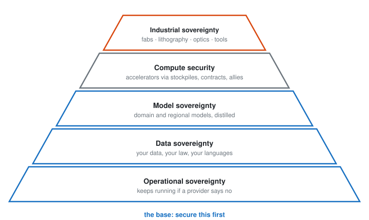

There's an old joke about a lecture on the cosmos, interrupted by someone insisting the world rests on the back of a giant turtle. What holds up the turtle? "It's turtles all the way down."

The AI supply chain is turtles all the way down, and each turtle is a wrapper around the one beneath it:

- **The AI product** is a wrapper around a model API.
- **The model** is a wrapper around accelerators: trained and served on NVIDIA GPUs or Google TPUs, with its weights shaped by the hardware they ran on.
- **The accelerator** is a wrapper around a design and a fab. Design is the visible moat, years of architecture and software. Fabrication is the quieter one: a craft perfected by a few, with TSMC taking about 70% of global foundry revenue in Q2 2025.[^foundry] Its memory comes from three suppliers, SK hynix with about half.[^hbm]
- **The fab** is a wrapper around lithography: EUV scanners from one Dutch company, ASML, built around US light-source modules and German lasers.[^asml]
- **ASML** is a wrapper around Carl Zeiss, its sole supplier of the mirrors and optics for EUV; Zeiss's output caps ASML's.[^zeiss]
- **Zeiss** is a wrapper around precision machine tools and materials. Machine tools have been strategic for decades: in the 1980s, milling machines sold to the Soviet Union cut quieter submarine propellers, and members of Congress smashed a Toshiba radio on the Capitol lawn in protest.[^kcl-toshiba][^upi-toshiba]
- **Under all of it:** neon for lithography lasers, more than half of it from Ukraine until 2022,[^neon] high-purity quartz for silicon crucibles, almost all of it from one North Carolina town that a hurricane shut for days in 2024,[^spruce-pine][^spruce-pine-minimal] and power, about 415 TWh for data centres in 2024, heading for around 945 TWh by 2030.[^iea]

Where does it end? Nowhere convenient. More than 50 points in the semiconductor supply chain have a single region holding over 65% of the global market.[^sia-bcg]

In 1954 the US Atomic Energy Commission promised electricity "too cheap to meter." Fuel was cheap; the plants and grid were not, and the meter stayed.[^strauss] In March 2026 the phrase came back with intelligence as "a utility, like electricity or water," sold "on a meter."[^altman-meter] If every hospital, court, ministry and company comes to need intelligence the way it needs electricity, the questions become a utility's: who owns the plant, where it sits, and what happens in an outage. Utilities attract tariffs, stockpiles, guarded plants and the language of national security, and so governments everywhere now talk about sovereign AI. Over a stack of turtles, what would that even mean?

* * *

Sovereignty arrives with analogies attached, and each one breaks somewhere.

- **A standing army?** Armies are sovereign capacity: force a state can use without asking permission. Yet most armies fly jets and run engines built abroad. Military sovereignty in practice means you can operate and maintain what you have, independently, and replace it through allies.
- **Military technology?** Governments already treat AI that way. The US controlled advanced AI chips and chipmaking tools in October 2022,[^bis-2022] and in January 2025 briefly wrote closed model weights into export law.[^gibson-dunn]
- **Owning the goods?** Full ownership means controlling every one of these: frontier and domain models with their training data; accelerator design and the software to design chips; leading-edge fabrication; high-bandwidth memory; EUV lithography; the optics inside it; specialty chemicals; gases and materials; power and cooling; precision machine tools.

The chemicals show how fast a single layer can bite. In July 2019 Japan restricted exports of photoresist, hydrogen fluoride and fluorinated polyimide to South Korea, home of the world's largest memory makers. Before the curbs, South Korea sourced 92% of its photoresist and 94% of its fluorinated polyimide from Japan.[^japan-korea]

So is full sovereignty achievable? No country has it, the United States included: its AI runs on Dutch lithography, German optics, Taiwanese fabrication and Japanese chemicals. Autarky over the whole stack is a myth. The useful question is which layers to own, in what order.

Maslow ordered human needs as a pyramid: physiological needs at the base, safety above them, then belonging, esteem and, at the top, self-actualisation. You don't pursue the upper levels while the base is unmet. AI sovereignty has the same shape:

- **Operational sovereignty (the base).** Your AI keeps running if a foreign provider, or its government, says no: serving capacity on your soil, open weights you hold, people who can run and fix it. The bare minimum, and the one to secure first.
- **Data sovereignty (safety).** Your data stays under your law, in your languages.
- **Model sovereignty (belonging).** Domain and regional models, adapted and distilled for your industries and languages.
- **Compute security (esteem).** Accelerator supply secured through stockpiles, contracts and allies.
- **Industrial sovereignty (self-actualisation).** Fabs, lithography, optics, machine tools: the summit some aim for and nobody completes alone.

Most sovereign-AI plans start at the summit (a national fab, a national chip) while the base stays unmet: a ministry whose chatbot stops if one API key is revoked. Public compute pools that rent subsidised GPUs to local startups and researchers start at the base instead. For policy, the pyramid sets the order of spending.

* * *

Operational sovereignty is an architecture before it is a policy. Drawn as a system, it has six parts:

- **A policy router** at the front door: it classifies each request by sensitivity and residency, decides where the work may run, and holds the failover plan.
- **A shared domestic serving pool:** open-weight models and distilled domain and language models, on GPUs inside the border, run by people inside the border.
- **A model registry** holding the weights locally, versioned and escrowed, so a licence change abroad can't take them away.
- **An evaluation harness** in local tasks and languages, the only way to know whether a domestic model is good enough for a court summary in Tamil or a claims form in Bahasa.
- **A distillation pipeline** that turns logged traces and graded examples into smaller students.
- **A frontier API across the border:** optional, for non-sensitive work, and mostly a teacher under contract.

We build data platforms and agentic systems for customers, so we have a stake in how this gets built.

The test is a drill: cut the border link for a week. Sensitive and essential work shouldn't notice; frontier-only features degrade, visibly and on purpose. Run it before a supplier or a government runs it for you.

* * *

What does intelligence cost at population scale? A utility sizes its grid from demand, and the same arithmetic works here. For $$U$$ people at $$D$$ tokens a day, a peak-to-average ratio $$f$$, and a GPU serving $$r$$ tokens per second at full batch, the fleet is

$$N = \frac{f\, U D}{86\,400\; r}$$

and the yearly cost per person, for a GPU-hour price $$h$$ at average utilisation $$u$$, is

$$A = \frac{365\, D\, h}{3600\; r\, u}$$

Four of the inputs are choices, and they vary by orders of magnitude:

- **Demand $$D$$:** about 2,000 tokens a day for occasional chat, 20,000 for a daily assistant, 200,000 for agents that resend context at every step
- **Model efficiency $$r$$:** illustratively 5,000 tokens per second per GPU for a small distilled model, 2,000 for a mid-sized open model, a few hundred for frontier-class models
- **Utilisation $$u$$:** 0.5 for a fleet sized for twice its average load; higher only by pooling demand
- **The hour $$h$$:** priced in dollars everywhere. H100 rental medians fell from $9.34 at hyperscalers in late 2024 to $1.95 on marketplaces by late 2025.[^silicon-data] Power is a small part of it: 700 W[^h100] with a 1.3 facility overhead at $0.10 per kWh is $0.09 an hour, under 5% of $2. The hour is mostly capital.

The fifth input is the one a country doesn't choose: income per head $$y$$. With $$h = \$2$$ and $$u = 0.5$$, set against the World Bank's income bands:[^wb-groups]

| Workload and model | Per person, per year | Low income ($1,000) | Lower-middle ($2,700) | Upper-middle ($10,000) | High ($60,000) |
|---|---|---|---|---|---|
| Assistant, small distilled model | $1.60 | 0.16% | 0.06% | 0.02% | <0.01% |
| Assistant, mid-sized open model | $4.10 | 0.41% | 0.15% | 0.04% | 0.01% |
| Agents, mid-sized open model | $41 | 4.1% | 1.5% | 0.41% | 0.07% |
| Agents, frontier-class model | $270 | 27% | 10% | 2.7% | 0.45% |

*Illustrative throughput and demand. Measure $$r$$ on your own models and hardware.*

So the economics reduce to one ratio:

$$\frac{A}{y} = \frac{365\, D\, h}{3600\; r\, u\, y}$$

$$h$$ is set globally and $$y$$ locally, and across economies $$y$$ spans more than fifty-fold. Everything else is engineering. A high-income economy can afford frontier agents for everyone. A lower-middle-income one can afford an assistant for everyone and agents for some, on distilled models at high utilisation. For most of the world, sovereignty is won on $$r$$ and $$u$$: small models and pooled grids.

Scale changes little of this. An assistant tier for 100 million people, about a twentieth of the 1.3 quadrillion tokens a month Google reported across its products in October 2025,[^google-tokens] needs about 23,000 GPUs and 21 MW,[^h100] 0.04% of what the world's data centres used in 2024.[^iea] DeepSeek-V3's final training run took 2.788 million H800 GPU-hours, priced by its authors at $5.6 million;[^deepseek-v3] that fleet burns the same GPU-hours in about five days and seventy times as many in a year. Serving is the bill, and a pool at 75% utilisation pays a third as much per token as one at 25%. Pooled demand is what makes a utility cheap, which argues for shared national or sector pools over a cluster per ministry. Meanwhile the headline plans are priced at the summit: the EU's InvestAI aims to mobilise €200 billion, including a €20 billion fund for AI gigafactories.[^investai]

* * *

How GPU-poor is each economy, relative to what its people already use? Two public datasets give a rough answer: Epoch AI's census of GPU clusters, in H100-equivalents,[^epoch-clusters] and Microsoft's share of working-age adults using AI at the end of 2025,[^ms-diffusion] applied to World Bank working-age populations.[^wb-wap] The model above gives the yardstick: an assistant tier at 20,000 tokens a day needs about 231 H100-class GPUs per million users.

| Economy | AI users (millions) | Tracked H100-equivalents | Per million AI users | Against the assistant-tier need |
|---|---|---|---|---|
| United States | 62.3 | 940,850 | 15,100 | 65× |
| Finland | 0.9 | 11,846 | 12,560 | 54× |
| Norway | 1.7 | 20,480 | 12,180 | 53× |
| Germany | 15.0 | 26,050 | 1,730 | 7.5× |
| Japan | 13.9 | 18,156 | 1,300 | 5.6× |
| Saudi Arabia | 6.8 | 8,391 | 1,240 | 5.4× |
| France | 18.5 | 16,119 | 870 | 3.8× |
| China | 159.2 | 109,411 | 690 | 3.0× |
| South Korea | 11.1 | 6,286 | 560 | 2.4× |
| United Kingdom | 17.1 | 7,972 | 470 | 2.0× |
| Singapore | 2.7 | 1,135 | 410 | 1.8× |
| Canada | 9.4 | 3,109 | 330 | 1.4× |
| United Arab Emirates | 5.8 | 1,749 | 300 | 1.3× |
| Brazil | 25.1 | 1,215 | 50 | 0.2× |
| India | 155.4 | 4,303 | 30 | 0.1× |
| Indonesia, Mexico, Pakistan, Philippines, Nigeria | 12 to 25 each | none tracked | 0 | 0 |

*Tracked clusters only, as of mid-2025.[^epoch-clusters]*

The caveats are large:

- **Coverage:** the census captures an estimated 10–20% of global GPU cluster performance, Chinese entries are anonymised and rounded, and most hyperscaler cloud regions and many national programmes are missing.[^epoch-clusters]
- **Location versus use:** Finland and Norway rank high on shared European supercomputers; American clusters serve the world. A GPU in another country is capacity you rent, which is the dependency this essay is about.
- **Demand moves:** AI adoption grew in every economy on Microsoft's list through 2025.[^ms-diffusion]

Even so, the shape is clear. A handful of economies hold many times their own assistant-tier demand. China and most of Europe hold a few times theirs. The largest pools of users, in India, Brazil, Indonesia, Mexico, Pakistan, the Philippines and Nigeria, hold a fraction of theirs or none on record, and rent the rest across a border.

* * *

How does an AI grid make money? The same way any grid does: sell capacity and meter usage, and recover capital before the asset ages out.

- **Capacity:** reserved GPUs under long contracts, ideally with an anchor tenant such as a government or a telco
- **Metered tokens:** wholesale to applications and distributors, priced per million
- **Services above the meter:** fine-tuning, evaluation, compliant hosting for regulated data

The risk is the price of the hour. A grid financed at 2024's rental prices and rented at 2025's loses money on every hour,[^silicon-data] and each hardware generation resets the curve. Grids that last will look like utilities: long contracts, high utilisation, regulated or anchor-backed returns. The middle of the stack is a thin-margin business.

Who makes the money, then?

- **The turtles below:** NVIDIA's data-centre revenue reached $193.7 billion in fiscal 2026, at a 71.1% company gross margin.[^nvidia-fy26] Much of every GPU-hour repays that margin, and in most countries it leaves the country.
- **Whoever owns the customer:** telcos and app platforms that put intelligence on a bill people already pay.
- **Owners of domain models:** data, evaluations and distribution in a vertical or a language are harder to copy than a GPU cluster.
- **Grid operators:** utility returns at best, losses when the hour reprices.
- **The economy at large:** most of the value lands as productivity in the work that uses the tokens, and none of it appears on the grid's income statement.

* * *

India has more AI users than any economy except China, on a GDP per head of $2,702 in 2025,[^india-gdp] in the World Bank's lower-middle-income band.[^wb-groups]

- **GPU poverty:** the census above tracks about 4,300 H100-equivalents in India. Counting the national programme's 38,000-plus GPUs[^indiaai] lifts that to about 270 per million AI users, if the two don't overlap: roughly the assistant tier for today's users, a sixth of it if every working-age adult took it up, and a tenth of an agent tier
- **Users:** ChatGPT's daily active users in India reached 73 million in late 2025, more than double the US figure;[^reuters-freebies] Reliance Jio alone has about 500 million customers.[^reuters-freebies]
- **The hour:** the national programme's common compute facility rents 38,000-plus GPUs at an average of about ₹65 per GPU-hour.[^indiaai]
- **The bill people already pay:** Jio's average revenue per user (ARPU) was ₹213.7 a month in the December 2025 quarter.[^jio-arpu]

An assistant for 500 million people, at 20,000 tokens a day on a mid-sized open model ($$r = 2{,}000$$, $$u = 0.5$$, $$h = \text{₹}65$$):

- **Fleet:** about 116,000 GPUs, three times what the programme has onboarded
- **Power:** about 106 MW, under 1 TWh a year
- **Cost:** about ₹6,600 crore a year: ₹132 per person, or ₹11 a month, about 5% of that ARPU
- **At twice the GPU-hour price:** ₹22 a month

Agents for 50 million people at 200,000 tokens a day need another 116,000 GPUs and cost about ₹110 a month each on a mid-sized open model, half the ARPU. On a frontier-class model the same agents cost about ₹730 a month, 3.4 times what the average customer pays for their phone.

So in India intelligence is affordable for everyone as an assistant on domestic, distilled models, and affordable as agents only for the top tier or on small models. The market is already pricing it that way. Late 2025 brought ChatGPT Go free for a year, Google's AI Pro free for 18 months to Jio's customers, and Perplexity Pro free for a year to Airtel's. Analysts read the offers as a hunt for users and for training data in India's languages.[^reuters-freebies] Intelligence is being sold the way mobile data was: bundled into a telco bill and priced in rupees per month.

Who makes money in India on this path? The telcos, which own the bill; foreign model owners, which collect the users and the data; and chip vendors abroad, which are paid for every imported GPU. Operational sovereignty keeps the ₹11 a month at home: a domestic grid running Indic, domain-distilled models at high utilisation, with the frontier as the teacher.

And operational sovereignty runs straight back to models. You can't keep AI running on your own soil without models you hold: for your domains (law, health, finance, agriculture), your regions and your languages. You will still want frontier models, but as machine tools.

The frontier model is also a machine tool, the machine that makes the machines. Its most consequential output is other models: synthetic training data, labelled edge cases, graded outputs, and the teacher that smaller students are distilled from. Distillation dates to 2015, when a small model trained to imitate a large one was shown to keep much of its skill at a fraction of the size.[^hinton-2015] It's now routine: DeepSeek shipped R1 in January 2025 together with smaller dense models distilled from its reasoning traces.[^deepseek-r1] The big model's job is to make the small ones good.

Machine tools end up controlled, and so do these. The January 2025 rule on model weights was rescinded four months later,[^kirkland] but the category survives the rule. My prediction: frontier weights end up near enriched uranium, licensed, audited, rented through metered APIs with know-your-customer checks, and kept off the open market. A handful of labs, each close to a government, will run the generating plants.

The serious objection is open weights. R1 shipped with its weights, and if the open frontier stays within months of the closed one there's nothing to guard. The number to watch is the lag between the best closed and best open model on agent tasks. If it holds near zero, I'm wrong. If it holds at a year while export rules tighten, the plants stay behind the fence.

Either way, the base of the pyramid is the same: models you hold, built or distilled for your domains, regions and languages, with the frontier as the machine tool that makes them. Most organisations need no power station of their own. They need to know what to run on the meter, and how little of it they can get away with.

> Nations guard the machines that make machines.
> Rent the generator; own what it powers.
> A utility is a supplier, and suppliers have outages.

[^hinton-2015]: Geoffrey Hinton, Oriol Vinyals and Jeff Dean, "Distilling the Knowledge in a Neural Network," arXiv:1503.02531, 2015. <https://arxiv.org/abs/1503.02531>
[^deepseek-r1]: DeepSeek-AI, "DeepSeek-R1: Incentivizing Reasoning Capability in LLMs via Reinforcement Learning," arXiv:2501.12948, 22 January 2025. <https://arxiv.org/abs/2501.12948>
[^bis-2022]: US Bureau of Industry and Security, "Commerce Implements New Export Controls on Advanced Computing and Semiconductor Manufacturing Items to the People's Republic of China," 7 October 2022. <https://www.bis.gov/press-release/commerce-implements-new-export-controls-advanced-computing-semiconductor-manufacturing-items-peoples>
[^gibson-dunn]: Gibson Dunn, "BIS Lays the Groundwork for Global and Metered Access to Frontier AI Models and the Computing Power to Train Them," January 2025, on the interim final rule of 13 January 2025 (ECCN 4E091, closed-weight models trained with more than 10²⁶ operations). <https://gibsondunn.com/bis-lays-groundwork-for-global-and-metered-access-to-frontier-ai-models-and-computing-power-to-train-them>
[^kirkland]: Kirkland & Ellis, "BIS Rescission of the Biden Administration's AI Diffusion Rule," May 2025 (rescission announced 13 May 2025). <https://www.kirkland.com/publications/kirkland-alert/2025/05/bis-rescission-of-the-biden-administration>
[^spruce-pine]: Megan Cassella, "How a tiny town hit by Helene could upend the global semiconductor chip industry," CNBC, 3 October 2024 (republished by NBC New York). <https://www.nbcnewyork.com/news/business/money-report/how-a-tiny-town-hit-by-helene-could-upend-the-global-semiconductor-chip-industry/5855037/>
[^spruce-pine-minimal]: Bloomberg via BNN Bloomberg, "North Carolina Quartz Mine Owner Says Helene Damage Was Minimal," 4 October 2024. <https://bnnbloomberg.ca/investing/2024/10/04/north-carolina-quartz-mine-owner-says-helene-damage-was-minimal>
[^strauss]: US Nuclear Regulatory Commission, "Too Cheap to Meter: A History of the Phrase" (Strauss's address to the National Association of Science Writers, 16 September 1954, and the industry reaction). <https://www.nrc.gov/reading-rm/basic-ref/students/history-101/too-cheap-to-meter.html>
[^altman-meter]: Business Insider via AOL, "Sam Altman says AI will eventually be sold like electricity and water — by companies like OpenAI," March 2026 (BlackRock U.S. Infrastructure Summit, 11 March 2026). <https://www.aol.com/news/sam-altman-says-ai-eventually-152157395.html>
[^neon]: CNBC, "Chip industry under threat with neon production set to fall off a cliff following Russia's invasion of Ukraine," 25 March 2022 (Ingas and Cryoin halted, per Reuters; Ukraine's share per Bain & Co.). <https://www.cnbc.com/2022/03/25/russia-ukraine-war-laser-neon-shortage-threatens-semiconductor-industry.html>
[^asml]: ASML, "Making EUV: from lab to fab," 2022. <https://www.asml.com/en/company/stories/2022/making-euv-lab-to-fab>
[^iea]: International Energy Agency, *Energy and AI*, executive summary, 2025 (data centres used about 415 TWh in 2024, around 1.5% of global electricity; base case of about 945 TWh by 2030). <https://www.iea.org/reports/energy-and-ai/executive-summary>
[^foundry]: TrendForce figures for Q2 2025 foundry revenue (TSMC 70.2%), as reported by Notebookcheck. <https://www.notebookcheck.net/Global-foundry-revenue-surged-to-41-7-billion-in-q2-2025-with-TSMC-capturing-a-record-70-percent-market-share.1102353.0.html>
[^hbm]: TrendForce, "HBM market heats up as three giants clash with HBM4 at the center," 17 September 2025 (SK hynix projected at 52.3% of 2025 HBM share). <https://www.trendforce.com/news/2025/09/17/news-hbm-market-heats-up-as-three-giants-clash-with-hbm4-at-the-center/>
[^indiaai]: Press Information Bureau, Government of India, IndiaAI Mission factsheet, February 2026 (38,000-plus GPUs available at ₹65 per hour). <https://static.pib.gov.in/WriteReadData/specificdocs/documents/2026/feb/doc2026217795001.pdf>
[^zeiss]: Tom's Hardware, "Zeiss expands German site that caps ASML's EUV scanner output," citing ASML's 2025 annual report (Carl Zeiss SMT is ASML's sole supplier of critical optical components). <https://www.tomshardware.com/tech-industry/zeiss-expands-german-site-that-caps-asmls-euv-scanner-output>
[^kcl-toshiba]: King's College London, "The Toshiba-Kongsberg case," 22 September 2014. <https://www.kcl.ac.uk/news/the-toshiba-kongsberg-case>
[^upi-toshiba]: United Press International, "Lawmakers hammer Toshiba," 1 July 1987. <https://www.upi.com/Archives/1987/07/01/Lawmakers-hammer-Toshiba/3984552110400/>
[^sia-bcg]: Semiconductor Industry Association and BCG, "Strengthening the Global Semiconductor Supply Chain in an Uncertain Era," April 2021. <https://www.semiconductors.org/wp-content/uploads/2021/03/SIA-BCG_Global-Value-Chain_2-pager.pdf>
[^japan-korea]: Japan Today, "Factbox: The high-tech materials at the heart of a Japan-S.Korea row," 2019 (import shares from Korea Trade Association data). <https://japantoday.com/category/business/factbox-the-high-tech-materials-at-the-heart-of-a-japan-s.korea-row>

[^google-tokens]: Sundar Pichai, "Q3 earnings call: Remarks from our CEO," Google, 29 October 2025 ("over 1.3 quadrillion monthly tokens," up from 980 trillion announced in July). <https://blog.google/inside-google/message-ceo/alphabet-earnings-q3-2025/>
[^h100]: NVIDIA, "H100 Tensor Core GPU" specifications (H100 SXM: up to 700 W, configurable). <https://www.nvidia.com/en-us/data-center/h100/>
[^deepseek-v3]: DeepSeek-AI, "DeepSeek-V3 Technical Report," arXiv:2412.19437, December 2024 (2.788M H800 GPU-hours for the official training run at an assumed $2 per GPU-hour; prior research and ablation experiments excluded). <https://arxiv.org/abs/2412.19437>
[^investai]: European Commission, "EU launches InvestAI initiative to mobilise €200 billion of investment in artificial intelligence," 11 February 2025. <https://digital-strategy.ec.europa.eu/en/news/eu-launches-investai-initiative-mobilise-eu200-billion-investment-artificial-intelligence>
[^silicon-data]: Silicon Data, "H100 rental price over time," H100 Rental Price Index (hyperscaler median $9.34 per GPU-hour, June to December 2024; July to December 2025: hyperscaler $6.26, neocloud $3.33, marketplace $1.95). <https://www.silicondata.com/blog/h100-rental-price-over-time>
[^wb-groups]: World Bank, "World Bank Country and Lending Groups," fiscal year 2027 (2025 GNI per capita, Atlas method: low income $1,175 or less; lower-middle $1,176 to $4,635; upper-middle $4,636 to $14,375; high above $14,375; India lower-middle). <https://datahelpdesk.worldbank.org/knowledgebase/articles/906519-world-bank-country-and-lending-groups>
[^nvidia-fy26]: NVIDIA, "NVIDIA Announces Financial Results for Fourth Quarter and Fiscal 2026," 25 February 2026 (data-centre revenue $193.7 billion; GAAP gross margin 71.1%). <https://investor.nvidia.com/news/press-release-details/2026/NVIDIA-Announces-Financial-Results-for-Fourth-Quarter-and-Fiscal-2026/default.aspx>
[^india-gdp]: World Bank data via FRED, "Gross Domestic Product Per Capita for India" (PCAGDPINA646NWDB), 2025: $2,702.48. <https://fred.stlouisfed.org/series/PCAGDPINA646NWDB>
[^reuters-freebies]: Reuters, "With freebies, OpenAI, Google vie for Indian users and training data," 18 December 2025, as republished by *Deccan Chronicle* (ChatGPT daily active users in India up 607% to 73 million per Sensor Tower; offers from OpenAI, Google with Reliance Jio, and Perplexity with Airtel). <https://www.deccanchronicle.com/technology/with-freebies-openai-google-vie-for-indian-users-and-training-data-1924649>
[^jio-arpu]: TelecomTalk, "Jio Posts 3Q FY26 ARPU of Rs 213.7, Subscriber Base Crosses 515 Million." <https://telecomtalk.info/reliance-jio-posts-3qfy26-arpu-of-rs213/1003600/>
[^epoch-clusters]: Epoch AI, "Data on GPU clusters" (formerly "AI Supercomputers"), CC BY, accessed November 2026 (H100-equivalents summed by country over existing, non-superseded clusters; the dataset covers an estimated 10–20% of global GPU cluster performance as of March 2025; Chinese systems anonymised and rounded). <https://epoch.ai/data/gpu-clusters>
[^ms-diffusion]: Microsoft AI Economy Institute, *AI Diffusion Report 2025 H2*, January 2026 (AI user share of the working-age population by economy, H1 and H2 2025). <https://www.microsoft.com/en-us/research/wp-content/uploads/2026/01/Microsoft-AI-Diffusion-Report-2025-H2.pdf>
[^wb-wap]: World Bank, World Development Indicators, "Population ages 15-64, total" (SP.POP.1564.TO), 2024. <https://data.worldbank.org/indicator/SP.POP.1564.TO>

