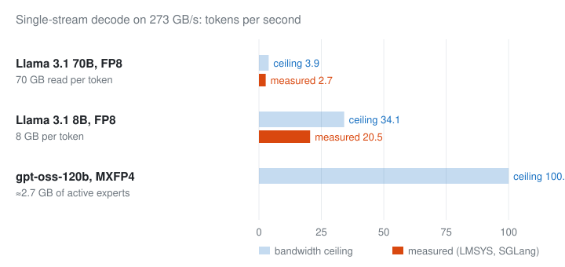
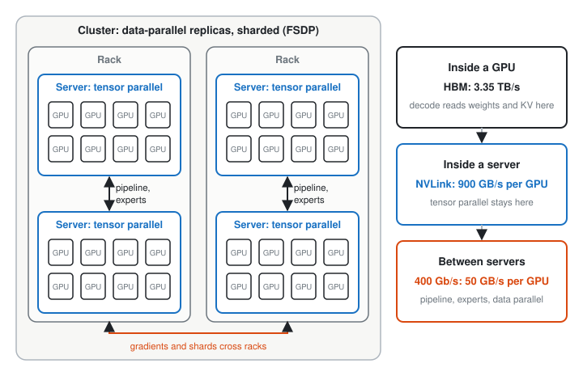

Work your way out of GPU poverty and the same question arrives at every team: can we serve intelligence ourselves, as a service, to everyone who needs it, air-gapped if we have to?

Appliances are back, this time shipping with a model, and the hardware is a purchase order:

- **tinybox (2024):** multi-GPU machines in one chassis, from $15,000 at launch.[^tinybox]
- **DGX Spark (October 2025):** book-sized, 128 GB of memory shared by CPU and GPU, a 240 W power supply, $3,999 at launch.[^spark][^spark-price]

At any non-trivial scale the economics of self-hosting can be compelling. How compelling depends on the class of model, on whether you train, serve or both, and on what the intelligence is for; [Too Cheap to Meter]({{ site.baseurl }}/ai-sovereignty-intelligence-utility/) works through that case. Here we take the case as made and work through the how, from one box on a desk to clusters that serve and train across racks.

We followed the question through, and each answer raised the next question.

* * *

**What will it actually run?**

The first surprise is that compute isn't the constraint. Each generated token reads the model's active weights from memory once, so single-stream speed has a hard ceiling:

$$\text{tokens/s} \;\le\; \frac{\text{memory bandwidth}}{\text{bytes read per token}}$$

Desktop appliances have plenty of capacity and little bandwidth: 273 GB/s on the Spark, about a twelfth of a datacentre H100's 3.35 TB/s.[^spark][^h100] On that box:

- **Llama 3.1 70B, FP8 (70 GB read per token):** ceiling $$273/70 \approx 3.9$$ tokens/s; measured 2.7, against 803 tokens/s of prefill.[^lmsys-spark]
- **Llama 3.1 8B, FP8:** 20.5 tokens/s for one user, 368 aggregate across a batch of 32.[^lmsys-spark]
- **gpt-oss-120b, MXFP4:** 117B parameters, about 5.1B active per token at 4.25 bits, roughly 2.7 GB read per token; ceiling around 100 tokens/s.[^gpt-oss]

So the answer is: big models that touch little per token. Mixture-of-experts models fit a capacity-rich, bandwidth-poor machine; dense giants fit and crawl.

*273 GB/s of unified memory. Measured values from October 2025;[^lmsys-spark] ceilings from the arithmetic above.*

**Can it make the model ours, by fine-tuning on our own data?**

Partly. Training holds far more in memory than serving does:

- **Full fine-tuning, 16-bit:** weights, gradients and optimizer state at once, more than 780 GB for a 65B model, so $$780/65 \approx 12$$ bytes per parameter.[^qlora] 128 GB covers roughly $$128/12 \approx 10$$B parameters, before activations.
- **QLoRA:** a frozen 4-bit model plus small trained adapters; 65B fits in under 48 GB.[^qlora] The "fine-tune 70B" headline assumes this.

Adapters are the realistic path: your documents, tools and tone layered onto an open model. And a box that's training is a box that isn't serving, which is the first hint that one machine will have more than one job.

**What if one box isn't enough?**

Link two, and the network sets the pace: a 200 Gb/s port moves 25 GB/s, a tenth of the memory bandwidth inside each box.[^spark] Distributed inference turns up on a desk.

* * *

**How do we know it's good enough?**

"Fast enough" has to become numbers before anyone depends on the box. For inference:

- **TTFT and ITL** (time to first token, inter-token latency) at p50 and p95: what users feel as responsive and fluent.
- **Goodput:** requests or tokens per second inside both latency targets. Peak throughput with latency ignored is a vanity number.
- **Concurrency:** users or agents sustained before targets break.
- **Tokens per joule and cost per million tokens, at the wall plug.** Software counters on unified memory are incomplete; `nvidia-smi` on the Spark reports no memory use at all.[^spark-k8s]
- **Quality on your own tasks:** a quantised model twice as fast that fails your evaluation set is a regression.

For fine-tuning: training tokens per second, time to converge on your data, and the result on the same evaluation set. The tools are free: GuideLLM for request-rate sweeps,[^guidellm] vLLM's `bench serve`, and NVIDIA's AIPerf for realistic arrival patterns.[^aiperf] Their metric definitions differ, so compare within one tool.[^llm-bench-concepts]

**And is it really "at the cost of power"?**

Electricity per million tokens, for a box drawing $$P$$ kW at $$c$$ dollars per kWh and producing $$r$$ tokens per second:

$$C_{10^6} = \frac{P \cdot c}{3600\, r} \times 10^{6}$$

With $$P = 0.24$$ (full draw) and $$c = 0.15$$ (illustrative), that's 3.6 cents an hour:

- **Dense 70B, one user (2.7 tokens/s):** about $3.70 of electricity per million tokens
- **8B, one user (20.5 tokens/s):** about $0.49
- **8B, batch of 32 (368 tokens/s):** under 3 cents
- **Hardware:** $3,999 over three years is about 15 cents an hour, four times the electricity

Power is the small line, and the spread across workloads is 136-fold on the same box. The cost per token is decided by model choice and batching, and batching means many users.

*Illustrative: 240 W at full draw, $0.15/kWh, $3,999 over three years.*

* * *

**So how do we run it, once other people depend on it?**

Every answer so far points the same way. Good economics need batching, so many users. Making the model ours means fine-tuning, so a second workload. Measuring needs benchmarks, a third. Big models need a second box. And the air-gap means every image, driver, weight and update arrives by one audited path. The box has turned into a small fleet with shared GPUs.

Three ways to run that, each right for someone:

| Option | Fits | Strains when |
|---|---|---|
| A single model server (Ollama, llama.cpp, or vLLM in a container) | One person, one model, quick experiments | A second user needs queueing, a second model needs the GPU, or updates have to be audited |
| A compose file of services on one box | A small team sharing one box | A second box arrives, jobs compete for GPUs, or you need rolling updates |
| A small Kubernetes distribution with the GPU Operator | Several workloads, several boxes, controlled air-gapped updates | There's one box and one user, or the hardware is so new the GPU tooling lags |

For one person experimenting, the single server wins: it answers in ten minutes, and Kubernetes would cost more than it saves. A compose file stretches surprisingly far on one box. Kubernetes has real costs, machinery to learn and run, and GPU tooling that trails brand-new desktop parts.

But each requirement the simple options lack has to be built by hand: a scheduler for shared GPUs, an update mechanism, an air-gap procedure, a way to reproduce the box. Kubernetes already has them as a [durable primitive](https://platformatory.io/platform-thesis/): declarative deployments, GPU scheduling, health checks, operators. Past the second user, workload or box, it's the cheaper path. (We build platforms on Kubernetes for customers, so we have a stake in this answer.)

The pieces exist, air-gapped included:

- **Distribution:** k3s and RKE2 both document air-gapped installs: images from a tarball or private registry, artifacts pre-downloaded, upgrades through the same registry.[^k3s-airgap][^rke2-airgap]
- **GPUs:** NVIDIA's GPU Operator installs driver, container runtime and device plugin, and lists the Spark as supported.[^gpu-operator] Community reports show device-plugin versions crashing or misallocating on unified memory, so pin and test.[^spark-k8s]
- **Serving:** vLLM or SGLang as the engine; llm-d's Kubernetes-native routing beyond one replica; LeaderWorkerSet when a model spans two linked boxes.[^llmd]
- **Air-gap:** a registry mirror for images, a model store for weights, one audited path in for updates, the same shape for every workload.

* * *

**What changes when the fleet becomes a cluster?**

Past a few boxes, the two workloads stop resembling each other. Serving is a service: many short requests, bound by latency, scaled out by adding replicas. Training is one synchronous computation spread over every GPU in the job, bound by throughput, and it fails as a unit. Both run on the same hardware hierarchy, and the hierarchy is the first constraint.

*H100 SXM figures;[^h100] one 400 Gb/s link per GPU, as in Llama 3's training cluster.[^llama3]*

Each step outward costs bandwidth: 3.35 TB/s of memory inside a GPU, 900 GB/s of NVLink between the GPUs of one server, 50 GB/s per GPU across the network. That's an 18-fold drop at the edge of the server, and every parallelism scheme is a decision about which data crosses it. Llama 3 orders its four, from the inside out, as tensor, context, pipeline and data parallel, and keeps tensor parallelism, the chattiest, inside the eight NVLinked GPUs of one server.[^llama3]

**How is one model served across many GPUs?**

The request splits before the model does. Prefill reads the whole prompt in one pass and is bound by compute; decode emits one token at a time and is bound by memory bandwidth, which is why the Spark managed 803 tokens/s of prefill and 2.7 of decode. Then the model splits, in one of five ways:

- **Data parallel:** a whole copy of the model per GPU or server, with a load balancer in front. The default whenever the model fits.
- **Tensor parallel:** each layer's matrices split across GPUs, with an all-reduce every layer. Fast inside a server; across servers vLLM's documentation asks for InfiniBand and calls a fallback to TCP "not efficient".[^vllm-parallel]
- **Pipeline parallel:** layers cut into stages, one per server, so only activations cross the network. vLLM's recipe for a model larger than a server is tensor parallel within each server and pipeline parallel across them.[^vllm-parallel]
- **Expert parallel:** a mixture-of-experts model's experts spread across GPUs, attention kept data-parallel, each token sent to the few experts it needs.[^vllm-parallel]
- **Disaggregated prefill and decode:** the two phases on separate GPU pools, each sized and split for its own bottleneck, with the KV cache shipped between them. DistServe served 7.4 times more requests within latency targets than colocated systems.[^distserve]

Once the weights are split, the bottleneck moves to the KV cache, the attention state each sequence keeps for every token it has seen:

$$\text{KV bytes per token} = 2 \times \text{layers} \times \text{KV heads} \times \text{head dim} \times \text{bytes per value}$$

Llama 3 70B has 80 layers, 8 KV heads and $$8192/64 = 128$$ dimensions per head.[^llama3] At 16 bits that's $$2 \times 80 \times 8 \times 128 \times 2 \approx 0.33$$ MB per token: 2.7 GB for an 8,000-token conversation, 43 GB for one at the full 128,000. An eight-GPU H100 server has 640 GB; 70 GB of FP8 weights leave about 570 GB, room for some 210 conversations of 8,000 tokens or 13 at full context, before activations. Cache memory, more than weights, sets concurrency, and concurrency sets the cost per token. So distributed serving is largely cache logistics: routing each request to the replica that already holds its prefix, offloading cold cache to CPU memory or disk, and moving cache from prefill to decode over RDMA.[^llmd][^dynamo]

**How is a model trained across many machines?**

Memory forces the split before speed does. Mixed-precision training with Adam keeps 16 bytes per parameter: 16-bit weights and gradients, plus 32-bit copies of the weights, momentum and variance.[^zero] QLoRA's "more than 780 GB" for 65B was a floor. At 16 bytes, a 70B model needs 1.12 TB for its training state, fourteen 80 GB GPUs before a single activation; 405B needs 6.5 TB. So the state is sharded, each GPU holding a slice and gathering layers as it needs them (ZeRO, and PyTorch's FSDP),[^zero] and the model is split as for serving, with context parallelism added for long sequences.[^llama3][^megatron]

The job is synchronous: every step waits for the slowest GPU, and one failure stops all of them. Even at the frontier the hardware delivers well under half its peak. Llama 3 405B trained at 38–43% model FLOPs utilisation on up to 16,000 H100s;[^llama3] Megatron-LM reached 52% on 3,072 GPUs in 2021.[^megatron]

**What runs all this on Kubernetes?**

| Layer | Serving | Training |
|---|---|---|
| Devices | GPU Operator; Dynamic Resource Allocation, stable since Kubernetes 1.34, requests GPUs and NICs by attribute rather than count[^dra] | The same |
| Network | RDMA NICs (InfiniBand or RoCE) attached to pods, GPUDirect RDMA, NCCL | The same, carrying far more |
| Engine | vLLM, SGLang, TensorRT-LLM | PyTorch FSDP, Megatron-LM, DeepSpeed, JAX |
| Unit of pods | LeaderWorkerSet: a multi-host replica created, placed and restarted as one[^lws]; Grove's PodCliqueSet for disaggregated roles[^grove] | JobSet: a group of Jobs recreated whole on failure, optionally one per rack[^jobset] |
| Queues and gangs | Shared with training when one cluster runs both | Kueue: quotas, all-or-nothing admission, placement by rack or block[^kueue-tas]; KAI Scheduler: gangs, hierarchical queues, GPU sharing[^kai]; Volcano; Slurm on Kubernetes via Slinky[^slinky] |
| Routing | Gateway API Inference Extension: an InferencePool and an endpoint picker that routes on prefix cache and LoRA adapters[^gie] | Not applicable |
| Platform | llm-d: prefix-aware scheduling, disaggregation, wide expert parallelism, tiered KV cache[^llmd]; NVIDIA Dynamo[^dynamo]; KServe's LLMInferenceService, built on llm-d[^kserve] | Kubeflow Trainer v2: a TrainJob over JobSet for PyTorch, DeepSpeed, Megatron-LM, JAX and more[^trainer]; KubeRay |
| Weights and checkpoints | A model store, and loaders that stream weights into GPU memory as they arrive[^streamer] | Storage sized for checkpoint bursts |

The pattern down the table: the pod is the wrong unit for both workloads. Each project adds a bigger one (a group, a gang, a set) that is scheduled, placed and restarted together, and teaches the scheduler a topology it otherwise can't see. Most of it is young. Kubeflow Trainer still calls itself alpha,[^trainer] llm-d reached 1.0 only in October 2026,[^llmd] and Grove and LeaderWorkerSet overlap. Pin versions, and expect to swap a layer.

**What breaks?**

At scale, failure is the steady state. Over a 54-day snapshot of Llama 3 405B pre-training on 16,384 H100s, Meta logged 419 unexpected interruptions, about one every three hours. Some 78% were confirmed or suspected hardware, led by faulty GPUs (30.1%) and HBM3 memory (17.2%). Six were silent data corruption: wrong numbers, no error.[^llama3] That's one failure per 50,000 GPU-hours or so. If failures scale with GPU count, a 1,024-GPU job meets one every two days.

Recovery means restarting from a checkpoint, and the interval has a classic answer. With $$\delta$$ the time to write a checkpoint and $$M$$ the mean time between interrupts, Young's first-order optimum, refined by Daly, is[^daly]

$$\tau \approx \sqrt{2 \delta M}$$

and the fraction of the run lost is roughly $$\delta/\tau + \tau/(2M)$$: writing checkpoints, plus redoing the work since the last one. At $$M = 185$$ minutes, a five-minute checkpoint gives $$\tau \approx 43$$ minutes and loses about 23% of the run. A 30-second one gives about 14 minutes and loses about 7%, before restarts. Write speed is the lever. Llama 3's storage sustained 2 TB/s and peaked at 7 TB/s, because checkpoints arrive as bursts that saturate it, and Meta kept effective training time above 90%.[^llama3]

The rest of the list, for serving:

- **Round-robin throws away the cache.** A plain load balancer scatters a conversation's turns across replicas, and each one recomputes the prefix. Route on cache and load.[^gie]
- **Busy isn't healthy.** A GPU can report itself fully used while latency targets break. Scale on queue depth, cache use or the targets themselves, as Dynamo's planner does.[^dynamo]
- **Cold starts are measured in weights.** A replica isn't ready until 70 GB, or several hundred, reach its GPUs. Pre-stage weights on nodes or stream them; in an air gap, from the model store inside it.[^streamer]
- **A multi-host replica lives and dies whole.** Lose one pod of a 16-GPU replica and the group restarts.[^lws] Rolling updates need spare capacity in replica-sized units: 16 free GPUs to surge one replica.
- **The network falls back quietly.** Without RDMA devices and the `IPC_LOCK` capability in the pod, NCCL drops to TCP; check its logs for `NET/IB/GDRDMA`. The container's default `/dev/shm` is too small, so mount a memory-backed volume.[^vllm-parallel]

And for training:

- **Gang or deadlock.** Two jobs that each get half their pods hold the whole cluster and progress on neither. Admit all or nothing.[^kueue-tas][^kai]
- **Placement is performance.** A job scattered across racks puts its chattiest traffic on the slowest links. Schedule by topology.[^kueue-tas]
- **Kubernetes restarts pods; training restarts jobs.** A replacement pod can't rejoin a collective that has moved on, so recovery is the whole job, from the last checkpoint.[^jobset]
- **Stragglers set the pace.** One slow GPU, hot node or flaky link slows every step. Llama 3 saw throughput swing 1–2% with the time of day, as mid-day heat changed GPU clocks.[^llama3]
- **Corruption doesn't crash.** It surfaces as a loss spike, or a worse model weeks later. A study of a large production fleet found hundreds of defective CPUs across hundreds of thousands of machines, and argued the problem is systemic;[^sdc] GPUs are no exception.[^llama3]
- **Power moves with the job.** Thousands of GPUs stalling and resuming together swing a data centre's draw by tens of megawatts.[^llama3]

An air gap compounds all of it. Driver, RDMA stack, NCCL and engine versions must match on every node, and each arrives through the one import path, so the cluster runs from a single tested bill of materials, upgraded as a whole.

**And for the CTO weighing this against an API?** Owning the box pays when:

- the data can't leave the building, by regulation or by choice
- usage is steady and high enough to keep batches full, where the per-token cost falls 100-fold
- an open model the size of the box does the job, judged on your own evaluation set

Rent the API when usage is spiky, the best model matters more than control, or there's nobody to run the platform.

* * *

So, can you serve intelligence yourself? Yes: the hardware is affordable, the models are good, and the power bill is small. At cluster scale the hard parts are moving bytes across the slowest link and surviving failure, and Kubernetes now has a project for each. The ownership that pays off is of the platform around the boxes, built once and reused on every box and rack after it.

[^tinybox]: Tom's Hardware, "TinyBox AI accelerator now available starting at $15k, available in 7900XTX and RTX 4090 variants," 2024; current models at <https://docs.tinygrad.org/tinybox/>. <https://www.tomshardware.com/pc-components/gpus/tinybox-ai-accelerator-now-available-starting-at-dollar15k-available-in-7900xtx-and-rtx-4090-variants>
[^spark]: NVIDIA, "DGX Spark" product page and specifications (128 GB LPDDR5x unified memory, 273 GB/s, up to 1 PFLOP FP4 with sparsity, ConnectX-7 at 200 Gb/s, 240 W power supply, 200B-parameter inference and 70B-parameter fine-tuning claims). <https://www.nvidia.com/en-us/products/workstations/dgx-spark/>
[^spark-price]: *The Register*, "Nvidia's GB10 Spark," 13 October 2025 (launch price). NVIDIA later raised the US price, citing memory supply. <https://theregister.com/2025/10/13/nvidia_gb10_spark>
[^lmsys-spark]: Jerry Zhou and Richard Chen, "NVIDIA DGX Spark In-Depth Review," LMSYS, 13 October 2025. The authors note that results may become outdated as software support matures. <https://www.lmsys.org/blog/2025-10-13-nvidia-dgx-spark>
[^gpt-oss]: OpenAI, gpt-oss-120b model card (116.8B total parameters, about 5.13B active per token; MoE weights in MXFP4 at 4.25 bits). <https://huggingface.co/openai/gpt-oss-120b>
[^qlora]: Tim Dettmers et al., "QLoRA: Efficient Finetuning of Quantized LLMs," NeurIPS 2023; arXiv:2305.14314. <https://arxiv.org/abs/2305.14314>
[^spark-k8s]: Collabnix, "Setting up a K3s Kubernetes cluster on NVIDIA DGX Spark with full GPU support" (community guide), and the NVIDIA Developer Forums thread "Blackwell GB10 GPU, device plugin v0.18.0, driver 580.95.05." <https://collabnix.com/setting-up-a-k3s-kubernetes-cluster-on-nvidia-dgx-spark-with-full-gpu-support/>; <https://forums.developer.nvidia.com/t/blackwell-gb10-gpu-device-plugin-v0-18-0-driver-580-95-05/348704>
[^guidellm]: Red Hat Developer, "Measure what matters: benchmarking and evaluation" (GuideLLM rate sweeps against OpenAI-compatible servers, with TTFT and ITL percentiles). <https://developers.redhat.com/learning/learn:openshift-ai:get-started-vllm/resource/resources:measure-what-matters-benchmarking-and-evaluation>
[^aiperf]: NVIDIA Technical Blog, "Benchmarking LLM Inference at Scale with AIPerf." <https://developer.nvidia.com/blog/benchmarking-llm-inference-at-scale-with-aiperf>
[^llm-bench-concepts]: NVIDIA Technical Blog, "LLM Benchmarking: Fundamental Concepts" (differences in metric definitions between tools). <https://developer.nvidia.com/blog/llm-benchmarking-fundamental-concepts>
[^k3s-airgap]: K3s documentation, "Air-Gap Install." <https://docs.k3s.io/installation/airgap>
[^rke2-airgap]: RKE2 documentation, "Air-Gap Install." <https://docs.rke2.io/install/airgap>
[^gpu-operator]: NVIDIA GPU Operator 26.7, "Platform Support" (DGX Spark listed under Blackwell). <https://docs.nvidia.com/datacenter/cloud-native/gpu-operator/26.7/platform-support.html>
[^h100]: NVIDIA, "H100 Tensor Core GPU" specifications (H100 SXM: 3.35 TB/s memory bandwidth). <https://www.nvidia.com/en-us/data-center/h100/>
[^llmd]: llm-d, GitHub repository (v1.0, October 2026: inference scheduler, disaggregation, tiered KV cache on vLLM and SGLang). <https://github.com/llm-d/llm-d>
[^llama3]: Aaron Grattafiori et al., "The Llama 3 Herd of Models," arXiv:2407.21783, July 2024 (revised November 2024): §3.3.1 infrastructure and storage, §3.3.2 parallelism and MFU, §3.3.4 reliability, Table 3 architecture, Table 5 interruption causes. <https://arxiv.org/abs/2407.21783>
[^distserve]: Yinmin Zhong et al., "DistServe: Disaggregating Prefill and Decoding for Goodput-optimized Large Language Model Serving," OSDI 2024; arXiv:2401.09670. <https://arxiv.org/abs/2401.09670>
[^zero]: Samyam Rajbhandari et al., "ZeRO: Memory Optimizations Toward Training Trillion Parameter Models," arXiv:1910.02054, 2019 (§3.1: 2Ψ + 2Ψ + 12Ψ = 16Ψ bytes for mixed-precision Adam). <https://arxiv.org/abs/1910.02054>
[^megatron]: Deepak Narayanan et al., "Efficient Large-Scale Language Model Training on GPU Clusters Using Megatron-LM," SC 2021; arXiv:2104.04473. <https://arxiv.org/abs/2104.04473>
[^vllm-parallel]: vLLM documentation, "Parallelism and Scaling." <https://docs.vllm.ai/en/latest/serving/parallelism_scaling.html>
[^dynamo]: NVIDIA Dynamo, GitHub repository (disaggregated serving, KV-aware routing, KV block manager, NIXL transfers, SLA-driven planner). <https://github.com/ai-dynamo/dynamo>
[^grove]: NVIDIA Dynamo documentation, "Grove" (PodCliqueSet, PodClique, PodCliqueScalingGroup; scheduling through KAI Scheduler). <https://docs.nvidia.com/dynamo/knowledge-base/kubernetes/multinode/grove.md>
[^lws]: Kubernetes SIGs, LeaderWorkerSet. <https://github.com/kubernetes-sigs/lws>
[^jobset]: Kubernetes SIGs, JobSet (failure policy recreates the whole JobSet; exclusive placement per topology domain). <https://github.com/kubernetes-sigs/jobset>
[^kueue-tas]: Kueue documentation, "Topology Aware Scheduling"; Kueue v0.15.0 release announcement (TAS for Kubeflow Trainer v2). <https://kueue.sigs.k8s.io/docs/concepts/topology_aware_scheduling/>
[^kai]: NVIDIA, KAI Scheduler (CNCF sandbox; Apache-2.0). <https://github.com/NVIDIA/KAI-Scheduler>
[^slinky]: SchedMD, Slinky slurm-operator. <https://slinky.schedmd.com/projects/slurm-operator>
[^gie]: Kubernetes SIGs, Gateway API Inference Extension. <https://gateway-api-inference-extension.sigs.k8s.io/>
[^kserve]: KServe, "KServe 0.17 release," March 2026 (LLMInferenceService on llm-d, disaggregated prefill and decode). <https://kserve.github.io/website/blog/kserve-0.17-release>
[^trainer]: Kubeflow Trainer, GitHub repository (v2.4.0, November 2026; status alpha). <https://github.com/kubeflow/trainer>
[^streamer]: Run:ai Model Streamer, GitHub repository. <https://github.com/run-ai/runai-model-streamer>
[^dra]: Kubernetes blog, "Kubernetes v1.34: DRA has graduated to GA," 1 September 2025. <https://kubernetes.io/blog/2025/09/01/kubernetes-v1-34-dra-updates/>
[^daly]: J. T. Daly, "A higher order estimate of the optimum checkpoint interval for restart dumps," Future Generation Computer Systems 22(3), 303–312, 2006 (extends J. W. Young's first-order estimate). <https://laro.lanl.gov/esploro/outputs/journalArticle/A-higher-order-estimate-of-the/9916364420003761>
[^sdc]: Harish Dattatraya Dixit et al., "Silent Data Corruptions at Scale," arXiv:2102.11245, 2021. <https://arxiv.org/abs/2102.11245>

