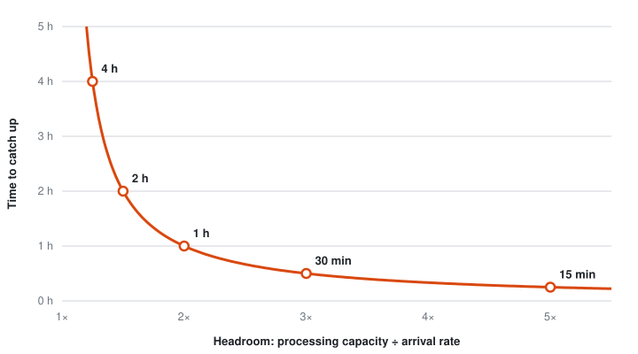

Moving Oracle changes into Kafka sounds simple: capture committed changes and publish them as events. We've written about doing it with [Debezium and LogMiner]({{ site.baseurl }}/debezium-oracledb-logminer/), with [OpenLogReplicator]({{ site.baseurl }}/debezium-oracledb-openlogreplicator/), and with [Confluent's Oracle CDC connector]({{ site.baseurl }}/Demystifying-Oracle-CDC-with-Confluent-Database-Kafka-Changes/). Since then the ground has shifted. Debezium's Oracle connector now offers four capture paths, Confluent ships a second Oracle connector built on XStream, and the question has moved from "how do we set it up?" to "why is it three hours behind?"

The setup is the easy part. A pipeline that moves 100,000 events a second in a benchmark can still fall hours behind at month-end, or take a day to recover from an outage. What decides throughput, lag and cost is where changes wait, how much spare capacity sits behind each wait, and who pays for the capture engine.

* * *

**What happens between an Oracle commit and a Kafka event?**

With XStream, seven stages:

- **Redo:** Oracle writes every change to the online redo logs, then archives them.
- **Capture:** a capture process mines the redo and turns changes into logical change records (LCRs).[^xstream-concepts]
- **Buffered queue:** LCRs wait in SGA memory, in the Streams pool, until their transaction commits. They spill to disk when they've waited too long, when a transaction holds too many, or when memory runs short.[^xstream-concepts]
- **Outbound server:** assembles committed transactions and streams them to one attached client.[^xstream-concepts]
- **Connector:** Debezium, or Confluent's connector built on it,[^confluent-xstream] turns LCRs into Kafka records and buffers them in a queue for Kafka Connect.
- **Producer:** batches, compresses and sends.
- **Broker:** replicates and acknowledges.

The client acknowledges progress by reporting a *processed low position*: the point below which every transaction has been handled. The outbound server keeps its own copy, updated on a timer (30 seconds by default for OCI clients), so after a restart it resends whatever it can't prove was processed, and the client must discard the duplicates.[^xstream-concepts] Delivery into Kafka is at-least-once; Confluent's documentation says so plainly.[^confluent-xstream] Consumers should be idempotent on the row key and the change's SCN.

Each stage has its own capacity, buffer and failure mode, and each exposes a number that says whether it's keeping up. Diagnosing lag means reading those numbers in order. Scaling Oracle, Connect or Kafka at random only moves money.

**Where do open transactions wait?**

This is the question the choice of capture path really answers. Oracle can only publish a transaction once it commits, so something has to hold the changes of every open transaction until then. The four paths put that something in different places:[^debezium-oracle]

| Capture path | Where open transactions wait | What breaks first under a long transaction | Extra Oracle licence |
|---|---|---|---|
| LogMiner, buffered (Debezium's default) | Connector JVM heap, or a disk-backed Infinispan or Ehcache buffer | Heap; the mining window can't advance past the oldest open transaction | No |
| LogMiner, unbuffered | Oracle PGA, since LogMiner returns committed changes only | `PGA_AGGREGATE_LIMIT` errors on large transactions | No |
| OpenLogReplicator | A separate process that reads redo files directly | That process's memory; little load on the database | No |
| XStream | The Streams pool in Oracle's SGA, spilling to disk | Streams pool pressure, then spill I/O | Yes: XStream is part of Oracle GoldenGate[^gg-licence] |

The table also explains why "LogMiner versus XStream" benchmarks diverge so widely. They mostly measure where a long transaction lands. LogMiner's `CONTINUOUS_MINE` option, which older tools relied on to follow log switches, was removed in Oracle 19c, so LogMiner-based connectors now track log switches themselves.[^logmnr-19c]

* * *

**What's the trade between throughput and latency?**

Batching amortises serialisation, network round trips, compression and producer overhead across more events, and every batch makes something wait. Two relationships bound the trade. The first is plain arithmetic:

$$\text{backlog growth} = \lambda - \mu$$

where $$\lambda$$ is the rate changes arrive and $$\mu$$ the rate the slowest stage can process them. If $$\lambda > \mu$$ for long, lag grows without limit, and no buffer size fixes it. The second is Little's law:

$$L = \lambda W$$

Events in flight equal throughput times average residence time. At 10,000 events a second and two seconds in the pipeline, 20,000 events are in flight; at 100 ms, 1,000.

How close to its capacity a stage runs also sets its wait. In the simplest queueing model, one server with random arrivals, time in the system is $$S/(1-\rho)$$ for service time $$S$$ and utilisation $$\rho$$: twice the service time at 50% busy, five times at 80%, ten times at 90%. Real pipelines aren't that simple, but the shape holds: a stage run hot turns small bursts into long waits.

**How much headroom does recovery need?**

More than most teams provision. After an outage of length $$D$$, the backlog is $$\lambda D$$, and it drains at $$\mu - \lambda$$ while new changes keep arriving. With headroom $$h = \mu/\lambda$$:

$$T_{\text{drain}} = \frac{\lambda D}{\mu - \lambda} = \frac{D}{h - 1}$$

For a one-hour outage, catching up takes four hours at 1.25× headroom, two at 1.5×, one at 2×, and 15 minutes at 5×:

*Assumes a one-hour outage, with arrivals continuing at the same rate during the catch-up.*

A pipeline sized at 1.25× peak looks healthy every day and takes four hours to recover from a one-hour outage, longer if the outage hit at peak. An SLO that promises recovery from a one-hour outage within 15 minutes is a promise of 5× headroom at the slowest stage. Say that before signing it.

Recovery also needs the redo to still exist. Capture restarts from the required checkpoint SCN, and every redo log from there on must be available.[^xstream-concepts] Archive retention has to cover the outage, the drain, and the age of the oldest open transaction, which holds the restart point back. At an illustrative 50 MB/s of redo, an hour's outage and 15 minutes' drain need 225 GB of archived logs on hand, before any long transaction stretches it.

* * *

**Is Oracle or Kafka the bottleneck?**

Neither, by default. The stage whose backlog grows is the constraint:

| Observation | Likely constraint |
|---|---|
| Capture falls behind redo generation | Mining: CPU, redo I/O, transaction reconstruction |
| Capture keeps up; the outbound low watermark lags | XStream delivery, or backpressure from the connector |
| The connector's queue sits near full | Record conversion in Connect, or Kafka publishing |
| Producer request latency rises | Brokers, network, replication or producer settings |
| Every stage keeps up; consumer lag rises | The downstream consumer |

Redo throughput and event throughput are different measurements. Oracle can write a lot of redo for changes that yield few events (index maintenance, uncaptured tables, LOB churn), and supplemental logging adds redo of its own. Compare captured LCRs per second with Kafka records per second; redo against records compares unlike things.

**How should XStream's memory be sized?**

Three settings, all in Oracle:

- **`STREAMS_POOL_SIZE`:** the shared pool XStream draws on. Oracle requires at least 300 MB, and recommends setting it explicitly rather than leaving it to automatic memory management.[^xstream-config] Left unset with automatic management off, the pool takes 10% of the shared pool on first use.[^streams-pool]
- **Capture `MAX_SGA_SIZE`:** the capture process's share of the pool.[^xstream-config]
- **Outbound `MAX_SGA_SIZE`:** the outbound server's share. The sum of every component's limit must stay below the pool size.[^xstream-config]

Oracle prescribes no ratio between capture and outbound. Equal shares are a sensible start; give capture more when transaction reconstruction dominates, and outbound more when delivery does, and decide from measured use and spill rather than by rule. Two apply parameters, `txn_lcr_spill_threshold` and `txn_age_spill_threshold`, set when LCRs spill, and Oracle notes that an outbound server performs best when few do.[^xstream-concepts] Capture `PARALLELISM` defaults to 0 for XStream Out, one process doing all the mining; raising it adds reader, preparer and builder processes.[^xstream-concepts]

More memory helps only when memory is the constraint. It can't buy CPU, faster redo reads or a faster Kafka cluster.

**Why do long transactions matter so much?**

A transaction that starts at 10:00 and commits at 10:30 can't be published at 10:01, however quickly its redo was mined. For thirty minutes something holds its changes, and on every path above, that something is finite. Meanwhile the restart point can't advance past it, so redo retention stretches with it.

The leading indicator is the age of the oldest open transaction that capture is tracking. Debezium's LogMiner adapter exposes it as `OldestScnAgeInMilliseconds`, alongside `NumberOfActiveTransactions`.[^debezium-oracle] Age alone misleads: a two-hour idle transaction and a five-minute one that updates ten million rows stress different things. Track the largest open transaction by LCRs or bytes too, and keep database-wide open transactions apart from the ones capture actually follows.

Two Debezium escape valves deserve care. `log.mining.window.max.ms` lets the mining window advance past a transaction that's been open too long, while still tracking it. `log.mining.transaction.retention.ms` discards transactions open longer than its value, and their changes are never emitted.[^debezium-oracle] The first trades memory for complexity; the second trades it for data loss.

* * *

**Which Oracle-side settings matter most?**

Roughly in order:

- **Capture scope:** capture only the schemas and tables you need; everything else is redo decoded for nothing.
- **Supplemental logging:** log the key columns correctness needs, and no more.[^xstream-config]
- **Streams pool and process memory:** sized against measured use and spill.
- **Redo and archive I/O:** enough for peak generation and for catch-up reads at the same time.
- **Transaction shape:** the application's batch jobs, purges and forgotten sessions.
- **Retention:** archives kept for the recovery window above.
- **RAC topology:** capture follows the queue's owning instance; set `USE_RAC_SERVICE`.[^xstream-concepts] Confluent reports persistent throughput drops after RAC failover on Oracle 19.30 and 19.31, which it attributes to an Oracle defect.[^confluent-rac]

Then measure, change one thing, and measure again under the same workload.

**How much does the connector's configuration matter?**

Less than its reputation, as long as nothing downstream is saturated. Debezium's main dials, with their defaults:[^debezium-oracle]

- **`max.batch.size` (2,048):** the most records handed to Connect per iteration. It's a ceiling: a batch returns before it fills, so raising it adds no wait.
- **`max.queue.size` (8,192):** the records buffered between the capture thread and Connect. Keep it larger than the batch size; `max.queue.size.in.bytes` adds a byte cap for wide rows and LOBs.
- **`poll.interval.ms` (500):** how long each iteration waits for new events. Not Oracle's mining interval.
- **`heartbeat.interval.ms` (0, off):** heartbeats keep offsets moving on quiet tables. Confluent recommends minutes to hours for its connector.[^confluent-xstream]

On the producer, `linger.ms` now defaults to 5 ms, not 0, since Kafka 4.0, because larger batches usually mean similar or lower latency.[^kip-1030] Compression and `acks` trade CPU, bandwidth and durability against latency.

A bigger queue absorbs a burst; it doesn't make a saturated stage faster. And some latency isn't configurable: Confluent's documentation notes about three seconds of extra latency when the database is quiet, from XStream's own batching.[^confluent-xstream]

**Is Confluent's XStream connector faster than Debezium's?**

The public evidence can't say. Confluent's connector is built on Debezium and Kafka Connect, and both use the same XStream outbound server.[^confluent-xstream] Confluent claims two to three times the throughput and latency of "traditional CDC approaches",[^confluent-blog] meaning LogMiner. The benchmarks sit in a gated whitepaper, and they compare XStream with LogMiner. Neither says anything about one XStream connector against another.

A fair head-to-head holds constant the Oracle version and workload, XStream settings, Kafka cluster and replication, serialisation, compression and `acks`, connector resources, transaction sizes and concurrency, and the starting backlog. Then the differences that remain (LCR conversion, allocation, buffering, checkpointing, restart) can show up, and their size will depend on the workload.

The licensing difference is clearer than the performance one, and larger. XStream is licensed as part of Oracle GoldenGate, which in turn requires Enterprise Edition.[^gg-licence] Debezium's XStream adapter needs that licence. Confluent's connector includes it, under an agreement with Oracle, in its own subscription.[^confluent-xstream] So the honest comparisons are a Confluent subscription against a GoldenGate licence plus running Debezium yourself, or against LogMiner or OpenLogReplicator, which need no extra Oracle licence and leave the long-transaction problem in your connector.

Confluent's connector has XStream's limits too: one outbound server per connector, since a server accepts one client; one pluggable database per connector; no capture on a Data Guard standby, where downstream capture is the workaround.[^confluent-xstream]

* * *

**What should a CDC service level measure?**

One "lag" number won't do. Four dimensions:

| Dimension | Measures |
|---|---|
| Freshness | p50, p95 and p99 commit-to-Kafka latency; age of the oldest committed change not yet in Kafka |
| Capacity | Redo MB/s; LCRs per second; Kafka records per second; measured maximum rate, giving headroom |
| Pressure | Capture and outbound progress; queue depth; spill; Streams pool use; oldest open transaction |
| Recovery | Redo retained against redo required; checkpoint age; restart time; drain rate |

SCN differences aren't seconds; convert through commit timestamps. And the age of the last processed event misreports freshness when tables are idle or a long transaction is open, which is what heartbeats are for.

A useful SLO names both steady state and recovery: *99% of committed changes visible in Kafka within five seconds at the agreed peak, and recovery from a one-hour outage within 15 minutes*. By the drain arithmetic, the second clause costs 5× headroom, and it's often the clause worth negotiating.

**What does reliable Oracle CDC cost?**

$$\text{cost} = \text{licences} + \text{infrastructure} + \text{operations} + \text{incidents and recovery}$$

Licences are Oracle's (Enterprise Edition and GoldenGate, for XStream) and the connector's. Infrastructure is database CPU and memory for capture, archive storage for retention, Connect workers, and Kafka capacity sized for the drain rather than the average. Operations is the people who understand capture, the Streams pool and Kafka at once, on call around the clock. A free connector gets expensive when every long transaction becomes a page; a subscription doesn't pay for itself by including support. We operate self-hosted Kafka, Flink and related data infrastructure for customers as a managed service, and predictability is worth more than peak throughput there.

**So what's the right architecture?**

Start from the business requirement: how fresh, at what peak, recovered how fast. Translate it into headroom with the drain formula. Pick the capture path by where you can afford open transactions to wait and what you're licensed for. Size Oracle and Kafka separately, instrument every boundary in the pipeline, and test the cases that hurt: a long transaction, a burst, a slow broker, a restart after an hour down.

Use open-source Debezium where it meets the workload and you can run it. Pay for a commercial connector when its measured behaviour, support or bundled licence beats the alternative on that test. Its own benchmark settles nothing.

[^xstream-concepts]: Oracle, *XStream Guide* 19c, "XStream Out Concepts" (capture process, LCRs, buffered queue and spill, outbound server and single client session, processed low position and acknowledgement interval, checkpoints and required checkpoint SCN, `PARALLELISM`, `USE_RAC_SERVICE`). <https://docs.oracle.com/en/database/oracle/oracle-database/19/xstrm/xstream-out-concepts.html>
[^xstream-config]: Oracle, *XStream Guide* 19c, "Configuring XStream Out" (Streams pool of at least 300 MB, `max_sga_size` for capture and outbound, supplemental logging). <https://docs.oracle.com/en/database/oracle/oracle-database/19/xstrm/configuring-xstream-out.html>
[^streams-pool]: Oracle Database Reference 21c, "STREAMS_POOL_SIZE." <https://docs.oracle.com/en/database/oracle/oracle-database/21/refrn/STREAMS_POOL_SIZE.html>
[^gg-licence]: Oracle GoldenGate Licensing Information (a GoldenGate licence includes Oracle XStream; Enterprise Edition is a prerequisite). <https://docs.oracle.com/en/middleware/goldengate/core/23/ogglc/oracle-goldengate.html>
[^logmnr-19c]: Oracle Database PL/SQL Packages and Types Reference 19c, "DBMS_LOGMNR" (`CONTINUOUS_MINE` desupported in 19c). <https://docs.oracle.com/en/database/oracle/oracle-database/19/arpls/DBMS_LOGMNR.html>
[^debezium-oracle]: Debezium documentation 3.7, "Debezium connector for Oracle" (adapters, buffer types, `log.mining.window.max.ms`, `log.mining.transaction.retention.ms`, queue and batch defaults, streaming metrics). <https://debezium.io/documentation/reference/stable/connectors/oracle.html>
[^confluent-xstream]: Confluent, "Oracle XStream CDC Source Connector for Confluent Platform" (built on Debezium and Kafka Connect; at-least-once delivery; XStream licence included; limitations; heartbeat and quiet-database latency notes). <https://docs.confluent.io/kafka-connectors/oracle-xstream-cdc-source/current/overview.html>
[^confluent-blog]: Mac Khajuria and Sudhindra Sheshadrivasan, "Meet the Oracle XStream CDC Source Connector," Confluent blog, 19 March 2025. <https://www.confluent.io/blog/oracle-xstream-cdc-connector/>
[^confluent-rac]: Confluent Support, "Why does Oracle XStream CDC Source Connector throughput drop after RAC failover." <https://support.confluent.io/hc/en-us/articles/52668236858260-Why-does-Oracle-XStream-CDC-Source-Connector-throughput-drops-after-RAC-failover>
[^kip-1030]: Apache Kafka, "KIP-1030: Change constraints and default values for various configurations" (`linger.ms` default from 0 to 5 in 4.0). <https://cwiki.apache.org/confluence/display/KAFKA/KIP-1030:+Change+constraints+and+default+values+for+various+configurations>

