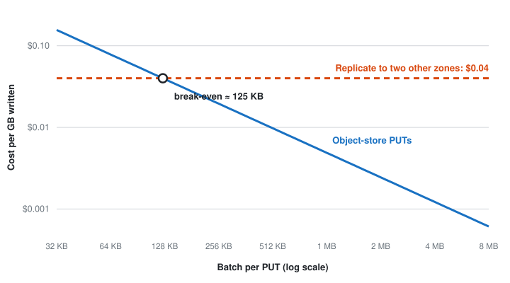

"Local NVMe or object storage?" sets up a binary that every storage system has already dissolved: each one is a memory hierarchy.[^thread] Three decisions remain. Which tier holds the truth, which tiers cache it, and what a miss costs at each boundary, in time and in money.

| | Local-disk design | Object-store design |
|---|---|---|
| Hot reads | RAM → local NVMe | RAM → local NVMe cache |
| Miss | Local NVMe, µs | Object store, 100–200 ms (standard) or single-digit ms (one-zone)[^s3-perf][^s3-express] |
| Durable commit | Replicate across zones, then ack | Write to the object store, then ack |
| Source of truth | Replicated local disks | Object store |
| Weak spot | Fixed capacity, slow rebuilds | Tail latency, cold caches |

Same working set, one round trip per durable write. They differ in where truth lives, what a miss costs, and what capacity and recovery cost.

* * *

**Every tier becomes a cache**

DRAM caches disk; disk once cached tape. SSDs made the network the bottleneck of network storage. Now local NVMe caches object storage. Each tier down is roughly ten times slower and buys capacity, durability, elasticity or a lower price per GB. Put each byte on the cheapest tier that meets its latency budget, and make misses rare and cheap. Our [napkin-math table]({{ site.baseurl }}/real-time-data-prime-time/) has the numbers.

When to cache has had a formula since 1987, the five-minute rule.[^5min] Keep a page in the faster tier if it's re-read within the break-even interval:

$$T = \frac{\text{pages per MB of RAM}}{\text{accesses per second per disk}} \times \frac{\text{price per disk}}{\text{price per MB of RAM}}$$

Recomputed in 2019 for 4 KB pages, DRAM over SSD came out at five minutes, DRAM over HDD at four hours, and newer non-volatile memory at under a minute.[^5min]

The cloud version swaps device prices for a bill. A local copy costs rent; a miss costs a GET. Re-reading an object of size $$s$$ more often than every

$$T = \frac{\text{price per GET}}{\text{cache price per GB-second} \times s}$$

makes the cached copy cheaper, before counting latency. At S3 Standard's $0.0004 per 1,000 GETs, with gp3 block storage at $0.08 per GB-month standing in for cache rent:[^s3-pricing][^ebs-pricing]

| Object size | Cache it if re-read within |
|---|---|
| 4 KB | about 37 days |
| 1 MB | about 3.6 hours |
| 64 MB | about 3.4 minutes |

Small objects and metadata: cache everything, because requests dominate the bill. Large segments read less often than every few minutes: leave them in the store. Latency only pushes the line towards caching more.

* * *

**Reads: the working set decides**

flowchart LR
    Q[Query] --> RAM{In RAM?}
    RAM -- hit --> A1[~100 ns]
    RAM -- miss --> NVME{On local NVMe?}
    NVME -- hit --> A2[~10s of µs]
    NVME -- miss --> SRC[Source of truth]
    SRC --> L[Replicated local disk or network block storage ~sub-ms]
    SRC --> O[Object storage single-digit ms one-zone 100–200 ms standard]

| Working set | Implication |
|---|---|
| Fits in RAM | Storage tier barely matters |
| Fits local NVMe but overflows RAM | Local flash decides; either design provides it |
| Wide and random (big keyspace, cold scans) | Misses dominate p99 and p999; local NVMe's flat tail wins |

The metric that matters is the hit ratio at each tier boundary. Instance type follows from it.

The local NVMe tier is bigger and faster than most designs assume. Flash costs under $200 per TB, 10 to 50 times less than DRAM, and a PCIe 4.0 SSD does over a million random 4 KB reads per second at 7 GB/s.[^haas] Spend the same money two ways on a $15,000 server:[^haas]

| Configuration | RAM | Flash | Bandwidth |
|---|---|---|---|
| All RAM | 2.5 TB | None | 150 GB/s from RAM |
| RAM plus SSDs | 0.5 TB | 8 × 4 TB | 150 GB/s from RAM, 56 GB/s from flash |

Eight SSDs measured 12.5 million random reads per second. Five storage engines on the same box (RocksDB, WiredTiger, PostgreSQL, MySQL and LeanStore as first built) reached a fraction of that; the best managed 3.6 million.[^haas] The hardware outran the software.

Little's law says why. Flash answers a random read in about 100 µs, so

$$\text{IOPS} = \frac{\text{I/Os in flight}}{\text{latency}}$$

and a thread that waits for each read gets 10,000 IOPS. Saturating the array takes about 1,000 reads in flight, more than 100 per device. At 12 million IOPS a 64-core server has some 13,000 CPU cycles per I/O, half of it spent just issuing and completing the request, unless the kernel is bypassed.[^haas] Engines that reach the hardware share a design:

- **Asynchronous I/O issued by the worker threads themselves:** io_uring, libaio or kernel-bypass SPDK; all three can saturate the drives, and SPDK spends the least CPU doing it.
- **Lightweight user-space threads**, so one core can switch between thousands of outstanding requests instead of blocking.
- **4 KB pages:** the best balance of IOPS, latency and amplification on flash. Smaller pages got slower, larger ones amplify.
- **Out-of-memory paths treated as hot:** eviction partitioned to handle tens of millions of pages a second.

Built that way, LeanStore ran TPC-C at 1.1 million transactions a second with data ten times the size of its 400 GB buffer pool, and 400,000 a second at forty times.[^haas] Mixed reads and writes cut the array to 6.7 million IOPS, since flash writes cost about ten times as much as reads. So a working set that fits local NVMe but overflows RAM can run close to in-memory speed, if the engine keeps enough I/O in flight. Check that before buying RAM, or before deciding the local tier is too slow and moving the truth to a slower one.

* * *

**Writes: durability costs one round trip**

sequenceDiagram
    participant C as Client
    participant P as Primary
    participant R as Replica (other AZ)
    participant S as Object store
    Note over C,R: Local-disk design
    C->>P: commit
    P->>R: replicate
    R-->>P: ack
    P-->>C: ack (one cross-AZ round trip)
    Note over C,S: Object-store design
    C->>P: commit
    P->>S: PUT (batched)
    S-->>P: ok
    P-->>C: ack (one object-store write)

One cross-zone round trip against one object-store write. Latency favours replication: a standard object-store write takes on the order of 100 ms, and the one-zone classes that reach single-digit milliseconds give up multi-zone durability.[^s3-perf][^s3-express] Cost can favour the store, depending on batch size.

Replicating to two other zones costs $0.01 per GB out and $0.01 in, per copy: $0.04 per GB written.[^xaz] A PUT costs $0.005 per 1,000 whatever its size,[^s3-pricing] so per GB the object store costs $$\frac{\$0.000005 \times 10^9}{b}$$ for batches of $$b$$ bytes:

*AWS US East list prices: $0.005 per 1,000 PUTs; $0.01 per GB each way across zones.*

The break-even batch is about 125 KB, and filling it takes time: $$b$$ divided by the writer's throughput. A writer producing 1 MB/s waits 125 ms per batch; at 10 MB/s, 12.5 ms. Object-store-first wins on cost for high-volume, log-shaped data, and pays for it in latency on low-volume streams. The sums leave out storage, consumer GETs, and the producer's own hop across zones.

* * *

Object storage is the best bottom tier. What it gives:

- Managed multi-zone durability.
- A small, immutable interface that pushes designs towards logs, now with conditional writes: `If-None-Match` since August 2024 and `If-Match` since November 2024, enough for writer fencing.[^s3-cond]
- Elastic capacity, cheap per GB and costly per request.
- Recovery by warming a cache, with no data to copy.

What you still own:

- Cache sizing, eviction and cold restarts, which usually arrive mid-incident.
- Metadata: the object set, ordering and writer fencing, typically backed by consensus.
- Compaction and garbage collection, or read amplification and a large bill.
- The miss path: S3 scales to at least 3,500 writes and 5,500 reads per second per prefix, returning 503s while it scales up.[^s3-perf] Throttling shows up in the tail.

Capacity and durability get simpler. The system doesn't: on-call moves to the cache and metadata layers.

* * *

Streaming systems have already made this move. We operate self-hosted Kafka, Flink and related data infrastructure for customers as a managed service, so we have a stake in where its data lives.

- **Tiered storage** ([KIP-405](https://cwiki.apache.org/confluence/display/KAFKA/KIP-405%3A+Kafka+Tiered+Storage)): hot segments local, cold segments in object storage. Early access in Kafka 3.6, production-ready in 3.9.[^kafka39]
- **Diskless topics** ([KIP-1150](https://cwiki.apache.org/confluence/display/KAFKA/KIP-1150%3A+Diskless+Topics)) and object-store-native Kafka-compatible systems: the write path on object storage, trading produce latency for no cross-zone replication traffic and nearly stateless brokers. KIP-1150 was accepted in March 2026; its implementation is in follow-up KIPs still under way.[^kip1150]

Choose per workload:

| Workload | Latency budget | Source of truth |
|---|---|---|
| Payments, orders, control plane | Low tens of ms, tight p99 | Replicated local disks, tiered history |
| CDC into analytics | Seconds | Tiered or diskless, by volume |
| Logs, metrics, clickstream | Seconds to minutes | Object storage first |
| Long-term replay | Throughput | Object storage behind a cache |

* * *

**Checklist**

- Working set against RAM and NVMe per node, measured.
- Miss rate at each tier boundary, and the latency behind it.
- I/Os in flight per NVMe device, the I/O interface, and page size: whether the engine can reach the drives at all.
- The p99 and p999 budget.
- Round trips per durable write, and how much batching the budget tolerates.
- Recovery: rebuild from peers or warm from the store, how long, and how degraded meanwhile.
- Cost: IOPS caps, provisioned throughput, cross-zone transfer, per-request charges, and the break-even object and batch sizes above.
- Who owns the cache, the metadata and compaction.

* * *

Miss-heavy OLTP belongs on local NVMe; high-volume logs belong in cached object storage. Durability costs a round trip either way. Pick the tier that holds the truth, cache the rest, and keep misses rare and cheap.

[^thread]: Thread on X. <https://x.com/jorandirkgreef/status/2118057836207104173>
[^s3-perf]: AWS, "Best practices design patterns: optimizing Amazon S3 performance" (at least 3,500 PUT and 5,500 GET requests per second per prefix; 503 Slow Down while scaling; small-object latencies of roughly 100–200 ms). <https://docs.aws.amazon.com/AmazonS3/latest/userguide/optimizing-performance.html>
[^s3-express]: AWS, "Amazon S3 Express One Zone" (single-digit millisecond access, single Availability Zone). <https://aws.amazon.com/s3/storage-classes/express-one-zone/>
[^5min]: Raja Appuswamy, Goetz Graefe, Renata Borovica-Gajic and Anastasia Ailamaki, "The Five-Minute Rule 30 Years Later and Its Impact on the Storage Hierarchy," *Communications of the ACM* 62(11), November 2019. <https://doi.org/10.1145/3318163>
[^s3-pricing]: AWS, "Amazon S3 pricing," US East (N. Virginia), S3 Standard: $0.005 per 1,000 PUT requests, $0.0004 per 1,000 GET requests. <https://aws.amazon.com/s3/pricing/>
[^ebs-pricing]: AWS, "Amazon EBS pricing," US East (N. Virginia), gp3: $0.08 per GB-month. <https://aws.amazon.com/ebs/pricing/>
[^xaz]: AWS Architecture Blog, "Exploring Data Transfer Costs for AWS Managed Databases" (cross-AZ traffic charged $0.01 per GB in each direction). <https://aws.amazon.com/blogs/architecture/exploring-data-transfer-costs-for-aws-managed-databases/>
[^s3-cond]: AWS, "Amazon S3 now supports conditional writes," 20 August 2024; "Amazon S3 adds new functionality for conditional writes," 25 November 2024. <https://aws.amazon.com/about-aws/whats-new/2024/08/amazon-s3-conditional-writes>; <https://aws.amazon.com/about-aws/whats-new/2024/11/amazon-s3-functionality-conditional-writes>
[^kafka39]: Apache Kafka, "Apache Kafka 3.9.0 Release Announcement," 6 November 2024. <https://kafka.apache.org/blog/2024/11/06/apache-kafka-3.9.0-release-announcement/>
[^kip1150]: Aiven, "KIP-1150 accepted, and the road ahead," 12 March 2026. <https://aiven.io/blog/kip-1150-accepted-and-the-road-ahead>
[^haas]: Gabriel Haas and Viktor Leis, "What Modern NVMe Storage Can Do, And How To Exploit It: High-Performance I/O for High-Performance Storage Engines," *PVLDB* 16(9), 2090–2102, 2023. <https://www.vldb.org/pvldb/vol16/p2090-haas.pdf>

